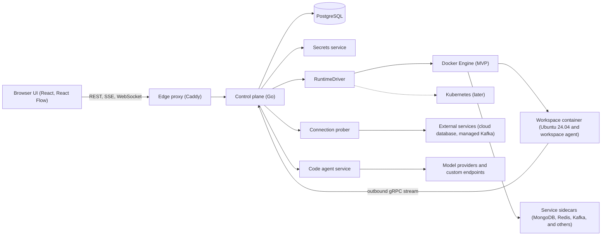

**![][image1]**

# **Project Ideation &** **Product Requirements**

An open-source, AI-native structured development workspace

**Build with AI. Engineer with structure.**

Version 0.6  |  Working Draft  |  October 2026

## **Version History**

| Version | Date | Summary of changes |
| :---- | :---- | :---- |
| 0.1 | October 2026 | Initial concept: workspace provisioning, technology catalog, drag-and-drop install workflow, architecture considerations. |
| 0.2 | October 2026 | Added **Install vs. Connect** modes for components. Users can attach externally hosted services (for example a cloud database or managed Kafka) instead of installing them. Added the properties panel with tabs, per-component connection forms, Test Connection, and Add to Workspace flow. Added Section 11, updated Sections 1, 3, 5, 7, 8, 10, 12, 14, 15, 17 and the acceptance criteria. Former Sections 11 to 17 are now 12 to 18. |
| 0.3 | October 2026 | Added **Workspace Settings** (Section 12): users can change the basic workspace configuration after creation, except the operating system. Added **Code Agent configuration**: choose a provider (Anthropic, OpenAI, Google, and others), select a model, supply the API key and provider-specific fields, and add custom or locally deployed models by endpoint and key. The same configuration appears on the main setup screen as a collapsible **Advanced Setup** section (new Section 6.4). Updated Sections 1, 3, 5, 6, 7, 14, 15, 16, 17 and the acceptance criteria. Former Sections 12 to 18 are now 13 to 19 (the Install vs. Connect cross-references were updated). |
| 0.4 | October 2026 | Added **Section 18, Feature Roadmap and Scoped Feature Specifications**, based on a review of comparable platforms (cloud development environments, AI app builders, and visual infrastructure canvases). 29 features (F1 to F29) are organized into four phases, each with scope, exclusions, dependencies, and acceptance criteria. Phase 1 remains the MVP defined in Sections 5 to 15. Updated Sections 1, 5, 15, 16, 17 and 20. Former Sections 18 and 19 are now 19 and 20. |
| 0.5 | October 2026 | Added **Section 19, Design System and UI Prompt Library**: brand foundations taken from the logo, a structure for writing good design prompts, a reusable master design prompt, a parallax-scroll landing page prompt, standard product page prompts (sign in, workspaces dashboard, Create Code Space, workspace canvas, Install and Connect properties panel, Workspace Settings, runtimes, system pages, docs), a review checklist, and open design decisions. Updated Section 17. Former Sections 19 and 20 are now 20 and 21. |
| 0.6 | October 2026 | Added **Section 20, Proposed Technical Architecture and Technology Stack**: an architecture diagram, a recommended stack (Go control plane and workspace agent, React and React Flow web app, Docker execution backend behind a pluggable driver, PostgreSQL, envelope-encrypted secrets, Caddy edge), reasoning for each major choice, proposed resolutions for the engineering items in Section 17, alternatives considered, spikes to run before committing, and a suggested Phase 1 build order. Updated the At a Glance table and Sections 13, 17, and 22. Former Sections 20 and 21 are now 21 and 22. |

# **Document Overview**

This document formalizes the initial concept for Nexmesh. It captures the product problem, vision, intended users, workspace lifecycle, technology catalog, installation workflow, and initial architecture considerations. It separates features explicitly described in the concept from future capabilities that still require product decisions.

## **At a Glance**

| Product name | Nexmesh |
| :---- | :---- |
| **Product type** | Open-source, browser-based development workspace |
| **Primary objective** | Make AI-assisted development more structured, understandable, and maintainable |
| **Default environment** | Ubuntu 24.04 LTS |
| **Core interaction** | Drag technologies onto a visual workspace, then either **install** them inside the workspace or **connect** to an existing external service (test the connection, then add it) |
| **Workspace settings** | Editable after creation (resources and general settings; the operating system is locked), including Code Agent provider, model, and API configuration |
| **Roadmap** | Four phases: (1) MVP workspace and connectors, (2) daily-use workspace, (3) structured AI development, (4) ship and scale. See Section 18 |
| **Design and UI prompts** | Brand tokens, master prompt, landing page and product page prompts. See Section 19 |
| **Technical architecture** | Proposed stack: Go control plane and workspace agent, React and React Flow web app, Docker execution backend, PostgreSQL. See Section 20 |
| **Initial scope** | Workspace provisioning and technology/service management, including externally hosted (bring-your-own) services |
| **Long-term direction** | Structured AI coding, architecture visibility, debugging, validation, and deployment workflows |

# **1\. Executive Summary**

AI coding models have made it easier to generate code, create APIs, build user interfaces, and configure common application components through natural-language prompts. However, code generation alone does not guarantee understandable architecture, maintainable modules, reliable debugging, compatible dependencies, or deployment readiness.

Nexmesh is proposed as an open-source, browser-based development workspace that brings the development environment and its technologies into a visible, structured system. Users create a code workspace, configure its resources, select technologies from a categorized catalog, choose supported versions, and install or start components inside the workspace. Selected technologies appear as cards on a central canvas.

Not every component needs to live inside the workspace. A team may already run MongoDB on a managed cloud service, Kafka on a hosted cluster, or Redis on a shared instance. For service-type components, users can therefore choose to **connect** to an existing deployment instead of installing a new one. They enter connection details, test the connection, and add it to the workspace so projects can use it exactly like an installed component.

Users also choose which AI model powers the workspace's code agent. Nexmesh is provider-neutral: the user selects a provider such as Anthropic, OpenAI, or Google, picks a model, and supplies their own API key, or points the workspace at a custom or locally deployed model through an endpoint. This can be set during workspace creation under Advanced Setup, or changed later in Workspace Settings.

Beyond the MVP, the product grows in phases. After a reliable workspace comes a daily-use layer (editor, terminal, Git, secrets, previews), then structured AI development (connected architecture canvas, canvas-aware agent with approvals, quality gates), and finally shipping and scale (deployment, scanning, teams, community catalog). Section 18 specifies each feature and its scope.

The product's core idea is not to eliminate AI coding. It is to provide a more disciplined environment for AI-assisted development, where the underlying tools, services, and eventually application structure can be inspected and managed instead of becoming a black box.

# **2\. Problem Statement**

## **2.1 Unstructured AI-assisted development**

AI-generated code can accelerate implementation, but unrestricted generation may leave developers with codebases they do not fully understand. This can happen to beginners using prompts to create entire applications and to experienced developers using AI to change existing modules quickly.

* Architecture is unclear: developers may not know how modules, APIs, databases, and services relate.  
* Code structure drifts: generated changes can introduce duplication, inconsistent patterns, or excessive coupling.  
* Debugging becomes difficult: errors may cross frontend, backend, runtime, and infrastructure boundaries.  
* Environment setup is fragmented: runtimes, framework versions, ports, environment variables, and services must work together.  
* Changes can have unintended effects: a prompt aimed at one feature may break another module.  
* Deployment gaps remain: a locally working application may not be reproducible or ready to deploy.

## **2.2 Product opportunity**

Nexmesh aims to make the development environment explicit and easier to reason about. The platform will start by structuring workspace creation and technology installation. That foundation can later support deeper capabilities such as architecture-aware AI assistance, dependency analysis, debugging, testing, and deployment workflows.

# **3\. Product Vision and Principles**

Vision: Build an open-source development workspace where developers can assemble and manage their technology stack visually, then use AI to build software within a clear, inspectable structure.

## **3.1 Product principles**

* Structured development: technologies and services are explicitly represented in the workspace.  
* Environment isolation: each code workspace has a defined execution environment and resource configuration.  
* Visibility: users can identify selected components and inspect their configuration and operational state.  
* Version control: supported technologies expose explicit version choices.  
* Developer ownership: users retain access to source code, configuration, and underlying tools.  
* AI as an engineering assistant: AI should operate within the project context, not obscure it.  
* Bring your own infrastructure: services that already exist elsewhere can be connected to the workspace and managed alongside installed components.  
* Model and provider choice: users pick the AI provider and model for their code agent, including self-hosted models, and keep control of their own keys.  
* Open-source extensibility: the catalog and execution integrations should be designed for future contributors.  
* Production-oriented foundations: prioritize reproducibility, least privilege, maintainability, and observability.

# **4\. Intended Users**

**Beginners and freshers:** Developers with basic programming knowledge who need help assembling an environment and understanding its components.

**Intermediate developers:** Developers who want faster implementation without losing control over architecture and maintainability.

**Experienced engineers:** Engineers who want AI-assisted productivity while retaining control over code, dependencies, and runtime behavior.

**Independent developers and small teams:** People building prototypes, MVPs, internal tools, or production applications in a repeatable environment.

# **5\. Initial Product Scope**

The first product stage focuses on workspace provisioning and visual technology management.

* Create a code workspace with an operating-system choice and resource allocation.  
* Use Ubuntu 24.04 LTS as the default environment.  
* Configure CPU, RAM, storage, and optional GPU access where supported.  
* Open a blank central workspace canvas after provisioning.  
* Browse a categorized technology sidebar.  
* Drag technologies onto the canvas and display them as cards.  
* Show a confirmation dialog before installation and startup.  
* Select supported versions for technologies and runtimes.  
* Install or configure selected technologies inside the designated execution environment.  
* Provide global language/runtime installation options for Python, Node.js, and Go.  
* Display component state so users can distinguish selected, installing, running, stopped, or failed components as the design matures.  
* For service-type components, offer two provisioning modes in a properties panel: **Install** (run it inside the workspace) or **Connect** (use an existing external deployment).  
* For Connect mode, provide a connection form specific to the selected component, a **Test Connection** action, and an **Add to Workspace** action that is enabled only after a successful test.  
* Store connection credentials securely and expose them to workspace projects in a controlled way.  
* Provide a Workspace Settings screen where users can change the basic workspace configuration after creation, except the operating system.  
* Let users configure a **code agent**: provider, model, API key and provider-specific fields, plus custom or locally deployed models with an endpoint and optional key.  
* Offer the same code agent configuration on the main setup screen as an optional, collapsible **Advanced Setup** section.

Scope note: configuring which code agent and model a workspace uses is in scope (Sections 6.4 and 12). What the agent does, how users interact with it, and what it is allowed to change are not yet defined. AI code generation behavior, automatic architecture enforcement, cross-component connection generation, automated debugging, and deployment pipelines are not yet defined as initial-release requirements. They are potential future directions. Several are now planned as later-phase features in Section 18; this section and Section 15 define Phase 1 only.

# **6\. Workspace Creation Flow**

## **6.1 Operating system**

The default base environment is Ubuntu 24.04 LTS. The user selects the workspace environment version during creation. Additional operating-system images may be considered later, once compatibility and support policies are defined.

## **6.2 Resource allocation**

* RAM: memory available to the workspace.  
* CPU: processing capacity or CPU quota allocated to the workspace.  
* Storage: persistent capacity for source code, dependencies, images, database data, and build artifacts.  
* GPU: optional acceleration, enabled only when the host/backend, drivers, runtime, and workload support it.

## **6.3 Create Code Space**

After configuring the environment, the user selects Create Code Space. The platform provisions the workspace and opens the canvas once readiness checks pass. The UI should expose meaningful provisioning states and errors rather than implying that the workspace is ready before it actually is. The operating system chosen here is fixed for the life of the workspace (Section 12.2).

## **6.4 Advanced Setup (optional)**

The main setup screen contains a collapsed **Advanced Setup** section below the resource settings. It is optional: users can create a workspace without opening it, and everything in it can be configured or changed later in Workspace Settings (Section 12).

Advanced Setup currently contains the **Code Agent** configuration, with the same fields, validation, and Test Connection behavior described in Section 12.3:

1. Select a provider (or Custom / Local model).  
2. Select a model.  
3. Enter the API key and any provider-specific fields.  
4. Optionally add custom or locally deployed models with an endpoint.  
5. Test the configuration.

Rules specific to the setup screen:

* Create Code Space is never blocked by an unconfigured agent. It is blocked only by an agent configuration the user has started and left invalid or untested; the UI explains this and lets the user clear the section or fix it.  
* Because the workspace does not exist yet, the test runs from the control plane or execution backend. For custom or local endpoints, reachability is re-verified from the workspace network after provisioning, and the result appears in Workspace Settings. A local endpoint that was reachable during setup may not be reachable from the workspace (see Section 12.5).  
* Credentials entered here are stored under the same rules as in Workspace Settings and are never shown again after saving.  
* Other advanced options may be added to this section in future versions.

# **7\. Main Workspace Experience**

## **7.1 Technology sidebar**

A categorized sidebar lists available technologies. Users browse or search the catalog and drag an item onto the canvas. Catalog entries should carry metadata such as component type, supported versions, installation method, resource requirements, ports, persistence needs, and prerequisites where relevant.

## **7.2 Central canvas and component cards**

The canvas starts blank. Each added technology is represented by a card. At minimum, a card should identify the technology and expose its current state. Later design work can define configuration panels, logs, terminal access, dependency links, health checks, and component-specific actions.

Clicking a card opens a **properties panel**. For service-type components, the panel shows two tabs, **Install** and **Connect**, described in Section 11. Each card also shows a mode badge (Installed or Connected) so users can tell at a glance whether a component runs inside the workspace or lives elsewhere.

A **Workspace Settings** entry point (for example a gear icon in the workspace header) opens the settings screen described in Section 12.

Important distinction: a visual card is a representation of a real configured resource, not merely a drawing. The platform should maintain a source-of-truth model linking each card to its desired configuration and actual runtime state.

# **8\. Initial Technology Catalog**

## **Database**

* **MongoDB —** Document-oriented database service.  
* **MySQL —** Relational SQL database service.

## **Backend**

* **Node.js —** JavaScript runtime used for server-side applications and tooling.  
* **NestJS —** Structured server-side framework for Node.js.  
* **FastAPI —** Python framework for building APIs.  
* **Python —** Language runtime for applications, services, and scripts.

## **Frontend**

* **React —** Library for component-based user interfaces.  
* **Angular —** Frontend application framework.  
* **HTML and CSS —** Web page structure and presentation technologies.

## **Event queues and messaging**

* **Kafka —** Distributed event-streaming platform.  
* **Redis —** In-memory data store used for caching, data structures, and selected messaging patterns.  
* **RabbitMQ —** Message broker for asynchronous service communication.

## **Scripting**

* **Python —** Runtime and language support for automation and scripts.  
* **JavaScript —** Runtime-dependent scripting support; Node.js may provide the execution runtime.  
* **Shell —** Command-interpreter environment for system and development tasks.  
* **Bash —** A specific shell implementation commonly used for automation.

## **Hosting and web infrastructure**

* **Nginx —** Web server and reverse proxy.  
* **Certbot —** Tool for obtaining and renewing TLS certificates with supported certificate authorities and web-server configurations.

Provisioning mode note: Install and Connect are not equally applicable to every entry. Connect mode applies to service-type components (MongoDB, MySQL, Redis, Kafka, RabbitMQ). Runtimes, frameworks, and system tools are install-only. The full matrix is in Section 11.2.

Catalog modeling note: catalog entries do not all represent the same kind of installable unit. Some are runtimes, some are frameworks or libraries, some are long-running services, and some are system tools. Nexmesh should model these differences explicitly so installation and lifecycle operations remain reliable.

# **9\. Global Language and Runtime Installation**

A separate workspace-level section will let users install programming-language runtimes independently of adding an application framework or service.

* Python  
* Node.js  
* Go

Users should be able to choose a supported version. The selected version must determine the actual installed runtime and be recorded in the workspace configuration. The implementation must define how multiple versions are handled, how upgrades work, and how projects pin their required versions.

# **10\. Drag-and-Drop Installation Workflow**

1. **Choose a component:** The user selects an item from the sidebar, such as MongoDB, React, NestJS, or Redis.  
2. **Drop onto the canvas:** The workspace displays a card representing the requested component.  
3. **Choose a mode and configure:** For service-type components, the properties panel offers **Install** and **Connect** tabs. Install shows the supported version, relevant settings, and an explicit install/start confirmation. Connect follows the flow in Section 11.3. Install-only components go straight to the install dialog.  
4. **Validate prerequisites:** The control plane checks resource limits, port conflicts, dependencies, compatibility, and required configuration.  
5. **Install or configure:** The execution backend performs the operation using a defined, auditable installation strategy.  
6. **Start if requested:** Installation and startup are tracked as separate lifecycle actions; successful installation does not imply successful startup.  
7. **Report actual state:** The card reflects observed status and provides access to relevant errors or logs where supported.

Steps 4 to 6 apply to the Install mode. The Connect mode replaces them with test-then-add, described next.

# **11\. Component Provisioning Modes: Install vs. Connect**

## **11.1 Concept**

Every service-type component can be provisioned in one of two modes:

| | **Install (managed)** | **Connect (external)** |
| :---- | :---- | :---- |
| Where it runs | Inside the workspace environment | Anywhere else: cloud-managed service, another server, shared team instance |
| Who operates it | Nexmesh, within the workspace | The user or their provider |
| Lifecycle actions | Install, start, stop, remove | Test, add, re-test, edit, disconnect |
| Resource cost to workspace | Uses workspace CPU, RAM, and storage | None, apart from client-side usage |
| Data persistence | Workspace volumes | Owned by the external service |
| Example | MongoDB container in the workspace | MongoDB Atlas cluster, managed Kafka, hosted Redis |

A component card has exactly one mode at a time. Switching modes on an existing card is a separate, confirmed action, because it changes where project data lives.

## **11.2 Mode applicability by catalog item**

| Component | Category | Install | Connect | Notes |
| :---- | :---- | :---- | :---- | :---- |
| MongoDB | Database | Yes | Yes | Service |
| MySQL | Database | Yes | Yes | Service |
| Redis | Messaging / cache | Yes | Yes | Service |
| Kafka | Messaging | Yes | Yes | Service |
| RabbitMQ | Messaging | Yes | Yes | Service |
| Nginx | Hosting | Yes | No (initially) | A remote reverse proxy has little meaning inside a workspace; revisit later |
| Certbot | Hosting | Yes | No | System tool |
| Node.js, Python, Go | Runtime | Yes | No | Runtimes are installed, not connected |
| NestJS, FastAPI | Backend framework | Yes | No | Frameworks are installed, not connected |
| React, Angular, HTML/CSS | Frontend | Yes | No | Install-only |
| JavaScript, Shell, Bash | Scripting | Yes | No | Install-only |

The catalog metadata should carry a `supportedModes` field (for example `[install, connect]`) so the UI shows the tabs only where they apply. Connecting to an external API or other web service could become a generic "External Service" component later; this is not defined yet.

## **11.3 Properties panel and Connect flow**

When the user clicks a service-type card, the properties panel opens with two tabs: **Install** and **Connect**.

**Install tab:** version selection, settings, resource requirements, and the install/start confirmation from Section 10.

**Connect tab:**

1. **Select the Connect tab.** The form shows the fields specific to the selected component (Section 11.4).  
2. **Enter connection information.** Users can fill individual fields or paste a connection string where the technology has a standard one. If a string is pasted, the form parses it into fields so the user can review each value.  
3. **Test Connection.** The user selects Test Connection. The platform runs the checks in Section 11.5 and reports a clear pass or fail with the reason.  
4. **Fix and retest if needed.** The form keeps the entered values (credentials stay masked) so the user can adjust and retest without retyping.  
5. **Add to Workspace.** This action is disabled until a test has passed against the current values. Editing any connection field invalidates the previous test result and disables the button again.  
6. **Component becomes available.** The card shows a Connected badge and its observed status. The connection details are exposed to projects as described in Section 11.6.

## **11.4 Connection fields per component**

Fields shown below are the baseline. Exact fields will follow each technology's client conventions.

| Component | Required | Optional / advanced |
| :---- | :---- | :---- |
| **MongoDB** | Connection URI, or host, port, database, username, password | Auth source, replica set name, TLS toggle and CA certificate, SRV connection |
| **MySQL** | Host, port, database, username, password | SSL mode, CA / client certificates, connection timeout |
| **Redis** | Host, port | Username, password, database index, TLS toggle and CA certificate, cluster mode |
| **Kafka** | Bootstrap servers | Security protocol (plaintext, SSL, SASL), SASL mechanism, username/password or API key and secret, CA certificate, schema registry URL and credentials, client ID |
| **RabbitMQ** | Host, port, username, password | Virtual host, TLS toggle and CA certificate, AMQP URL, management API URL |

Every connection also has a user-defined **connection name** (for example "prod-orders-db") and an optional **environment label** (development, staging, production) shown on the card, so users do not confuse environments.

## **11.5 Test Connection**

The test must run from the **execution backend or the workspace network, not from the browser**. Browsers cannot open raw database or broker connections, and the workspace is the party that actually needs network access to the service.

Checks, in order, with a specific error category for each failure:

1. **Input validation:** required fields present and well formed.  
2. **DNS resolution:** the host resolves.  
3. **Network reachability:** a TCP connection opens within the timeout (catches firewalls, IP allow-lists, wrong ports).  
4. **TLS handshake:** certificate is valid and trusted, or the supplied CA is accepted.  
5. **Authentication:** the credentials are accepted.  
6. **Authorization (basic):** a minimal read-only operation succeeds (for example a ping, a server-info call, or listing topics or databases the account may see).  
7. **Server details:** detect and display the server version and latency, and warn if the version is outside the supported or tested range for that component.

Test rules:

* Tests are read-only and must not create, modify, or delete data on the remote service.  
* Each test has a bounded timeout and the control plane rate-limits repeated tests.  
* Failure messages are specific and actionable (for example "Host reachable but authentication failed") and never echo secrets.  
* A passing result is tied to the exact field values tested. Any change invalidates it.  
* Results (pass/fail, category, time, latency) are recorded as audit events without secret values.

## **11.6 Add to Workspace and usage in projects**

On Add to Workspace, the platform:

1. Persists the connection configuration as the component's **desired state**, with the mode set to `connected`.  
2. Stores secrets in a dedicated secrets store. The component record holds only a reference to them.  
3. Exposes connection details to the workspace in a defined way, for example as environment variables with predictable names derived from the connection name, so project code and tools can use them. The exact naming and injection mechanism is an open decision (Section 17).  
4. Starts periodic or on-demand **health checks** so the card reflects the **observed state**.  
5. Updates the canvas card with the Connected badge, environment label, and status.

Actions available on a connected component: **Re-test**, **Edit** (requires retest before saving), **Rotate credentials**, **Disconnect**. Disconnect removes the connection from the workspace and its stored secrets. It never deletes data on the external service.

Installed-only actions (install, start, stop, version upgrade, volume management) are not shown for connected components.

## **11.7 States for connected components**

| State | Meaning |
| :---- | :---- |
| Draft | Card added, no connection details saved |
| Testing | A connection test is running |
| Test failed | The last test failed; the reason is shown |
| Test passed | The last test passed for the current values; Add to Workspace is enabled |
| Connected | Added to the workspace and healthy |
| Degraded / Unreachable | Added, but recent health checks fail (network, credentials expired, service down) |
| Disconnected | Removed from the workspace |

## **11.8 Security requirements**

* Secrets are encrypted at rest, masked in the UI, never written to logs, audit events, error messages, or the card, and are write-only after saving (users can replace them but not view them).  
* TLS is the default for non-local hosts. Disabling certificate verification requires an explicit, visible opt-out with a warning.  
* Outbound connections from Test Connection and from the workspace are subject to an egress policy. The platform must guard against server-side request forgery, for example by blocking cloud metadata addresses and, unless explicitly allowed, internal or private network ranges.  
* The UI recommends least-privilege credentials (for example a dedicated user with access limited to the project's database) and warns when the environment label is production.  
* Credential changes, connects, disconnects, and test results are recorded as audit events.  
* Connecting is user-initiated only. Nothing in the workspace should discover or connect to external services automatically.

## **11.9 Data model implications**

Each component record gains:

* `mode`: `installed` or `connected`  
* `connection`: component-specific, non-secret settings (host, port, database name, TLS flags, environment label)  
* `secretRef`: pointer to stored credentials  
* `lastTest`: result, category, timestamp, latency, detected server version  
* `desiredState` and `observedState`, as for installed components, with connected-specific states from Section 11.7

The desired-state versus observed-state separation from Section 13.1 applies unchanged. For connected components, observed state comes from health checks instead of process or container status.

# **12\. Workspace Settings and Code Agent Configuration**

## **12.1 Overview**

Workspace Settings lets users review and change how an existing workspace is configured. It is opened from the workspace header and is organized into tabs:

* **General:** workspace name and description, and the locked operating-system information.  
* **Resources:** CPU, RAM, storage, and GPU.  
* **Code Agent:** provider, model, credentials, and custom or local models (Section 12.3).

Every change is validated before saving, shows a summary of what will change and whether a restart is needed, and is recorded as an audit event.

## **12.2 General and resource settings**

Users can change any setting they chose during workspace creation **except the operating system**. The operating system and its version are shown read-only with a short explanation that changing them would require creating a new workspace.

| Setting | Editable | Rules |
| :---- | :---- | :---- |
| Workspace name, description | Yes | Name must be unique for the user |
| Operating system and version | **No (locked)** | Displayed read-only; fixed at creation |
| RAM | Yes | Validated against backend limits and host capacity; may require restart |
| CPU | Yes | Validated against backend limits and host capacity; may require restart |
| Storage | Yes, increase | Increasing is allowed within limits. Reducing is rejected if it would fall below current usage, and may be disallowed entirely depending on the storage backend (open decision) |
| GPU | Yes, where supported | Available only when the backend, drivers, and runtime support it; may require restart |

Behavior of changes:

* The screen shows which changes apply immediately and which require a workspace restart. The user confirms before anything restarts.  
* Changes that cannot be satisfied (unavailable resources, unsupported combinations) are rejected with a clear error, as at creation time.  
* The change is recorded as the new desired state. The UI reports the observed state once it has been applied.  
* Running components and stateful data are preserved across a restart according to the persistence policy.

## **12.3 Code Agent configuration**

The Code Agent tab lets the user choose which AI model powers the workspace's code agent. The tab holds one or more **agent model configurations**. One configuration is marked as the workspace default.

**Step 1: Provider.** Select from:

* Anthropic  
* OpenAI  
* Google  
* Other hosted providers, added as the catalog grows (for example Azure OpenAI, AWS Bedrock, Mistral, or an aggregator service)  
* **Custom / Local model** (Section 12.4)

The provider list should be catalog-driven, like the technology catalog, so contributors can add providers without changing the core UI.

**Step 2: Model.** After a provider is chosen, the user selects a model from a dropdown. The list should be fetched from the provider once the credentials validate, with a manual model-ID entry as a fallback when the list cannot be fetched or a model is newer than the list. Model names are not hard-coded in the document because they change often.

**Step 3: Credentials and provider fields.**

| Provider | Required | Optional / advanced |
| :---- | :---- | :---- |
| **Anthropic** | API key | Base URL (for proxies or gateways) |
| **OpenAI** | API key | Organization ID, project ID, base URL |
| **Google** | API key (Gemini API), or project ID, location, and service-account credentials (Vertex AI) | Base URL |
| **Other hosted providers** | Provider-specific (for example endpoint, deployment name, API version, region, access credentials) | Defined per provider in the catalog |

Common settings for every configuration, with sensible defaults:

* Configuration name (for example "Claude for backend work")  
* Maximum output tokens  
* Temperature or equivalent sampling settings, where the model supports them  
* Context window size (detected where possible, otherwise user-supplied)  
* Request timeout and retry count

**Step 4: Test.** The user selects **Test Configuration**. The platform checks that the required fields are present, that the endpoint is reachable, that the key is accepted, that the selected model is available to that key, and that a minimal request succeeds. Failures return a specific reason (invalid key, model not available, quota exceeded, endpoint unreachable, and so on). The key and request content are never echoed in error messages.

**Step 5: Save.** Save is enabled only after a successful test against the current values, using the same invalidate-on-edit rule as Connect mode (Section 11.3). The saved configuration appears in the list with its provider, model, status, and a default marker.

Actions on a saved configuration: **Edit** (requires retest), **Set as default**, **Replace API key**, **Re-test**, **Delete**.

## **12.4 Custom and locally deployed models**

Selecting **Custom / Local model** lets the user register any model served through an API they control, such as a model running on their own server, a self-hosted inference service, or a private gateway.

| Field | Required | Notes |
| :---- | :---- | :---- |
| Configuration name | Yes | Display name |
| Endpoint base URL | Yes | For example an HTTPS URL on an internal server |
| API protocol | Yes | OpenAI-compatible, Anthropic-compatible, Ollama-native, or other supported protocol, so Nexmesh knows how to call it |
| Model ID | Yes | The identifier the endpoint expects |
| API key / token | Optional | Many local servers need none; others require a token |
| Authentication style | If a key is given | Bearer token, or a custom header name |
| Custom headers | Optional | Additional static headers (values are treated as secrets) |
| TLS settings | Optional | Custom CA certificate; option to disable verification only with an explicit warning |
| Context window | Recommended | Often cannot be detected from custom endpoints |
| Declared capabilities | Recommended | Streaming, tool/function calling, image input, so the agent only uses what the model supports |
| Timeout and retries | Optional | Local models can be slow; defaults are higher than for hosted providers |

The Test Configuration step works the same way as for hosted providers. A custom endpoint that cannot report its capabilities relies on the user's declared capabilities, and the UI warns that behavior may be limited if the model lacks features the agent needs.

## **12.5 Networking and reachability**

* Tests and agent requests run from the execution backend or control plane, not the browser, so model endpoints need not allow browser (CORS) access.  
* A "local" model that runs on the user's own machine at an address such as localhost is reachable only if the model-calling component runs on that machine. This depends on the execution model (local agent, remote workspaces, or hybrid) and must be stated in the UI when a user enters a loopback or private address. With remote workspaces, such addresses will fail the test unless the user exposes the model through a reachable endpoint.  
* The same egress policy and server-side request forgery protections from Section 11.8 apply: cloud metadata addresses are blocked, and private ranges are allowed only where the deployment's policy permits.

## **12.6 Security and privacy**

* API keys, tokens, and custom header values are encrypted at rest, masked in the UI, write-only after saving, and excluded from logs, audit events, and error messages.  
* By default, agent credentials are **not** injected into the workspace environment, so project code and installed packages cannot read them. Only the component that calls the model has access.  
* When a hosted provider is selected, the UI states that prompts and project context sent to the agent leave the workspace for that provider. Local or self-hosted models keep that traffic within the user's own infrastructure.  
* Users bring their own keys, so usage costs and rate limits belong to the user's provider account. The UI should say so plainly. Showing usage or spend inside Nexmesh is a possible later feature.  
* Key replacement, configuration changes, default changes, and deletions are recorded as audit events.  
* Deleting a configuration deletes its stored credentials from Nexmesh. It does not revoke the key at the provider; the UI reminds users to revoke it there if needed.

## **12.7 Data model implications**

Each workspace gains:

* `settings`: name, description, resource configuration (desired state), with the operating system recorded as immutable  
* `agentConfigs[]`: for each configuration, `id`, `name`, `provider`, `modelId`, `endpoint` (custom only), `protocol` (custom only), non-secret parameters (tokens, temperature, timeouts, context window, declared capabilities), `secretRef`, `lastTest` (result, category, timestamp), and `isDefault`  
* `defaultAgentConfigId`

Workspace export or reproduction records non-secret settings only. Credentials must be re-supplied, consistent with Section 13.1.

# **13\. Proposed High-Level Architecture**

The concept describes a browser interface and a Docker-based execution environment. A browser cannot, by itself, safely provision and manage a full Ubuntu environment or a Docker daemon on the user's machine. Nexmesh therefore needs a clearly defined execution model: local execution through an installed agent/runtime, remote workspaces managed by a server, or a hybrid model. A concrete architecture and technology proposal is in Section 20.

* **Browser UI:** Workspace canvas, catalog, resource forms, component cards, dialogs, and status presentation.  
* **Control plane / API:** Workspace lifecycle, authorization, desired-state configuration, operation scheduling, audit events, and status aggregation.  
* **Execution backend:** Container runtime or workspace manager responsible for creating environments and applying component configurations.  
* **Workspace environment:** Ubuntu-based environment with source code, development tools, and the services selected by the user.  
* **Connection manager and secrets store:** Handles connection tests, health checks, and secure storage and injection of credentials for connected components, and stores code agent credentials.  
* **Agent configuration service:** Stores agent model configurations, tests them, and gives the code agent runtime access to credentials without exposing them to workspace code.  
* **State and metadata store:** Workspace definitions, component versions, installation state, resource configuration, and operation history.

## **13.1 Important implementation considerations**

* Separate desired state (what the user configured) from observed state (what is actually running).  
* Use technology-specific installers or declarative templates rather than one generic shell command for every catalog item.  
* Treat installation as an asynchronous operation with progress, logs, cancellation policy, and recoverable failure states.  
* Use persistent volumes for source code and stateful services where data must survive container recreation.  
* Avoid privileged containers by default; define resource limits, filesystem boundaries, secrets handling, and network policies.  
* Do not expose Docker socket access to untrusted code without a carefully designed isolation and threat model.  
* Make local GPU availability a backend capability check, not just a browser-side hardware check.  
* Record image/runtime versions and configuration so a workspace can be reproduced.  
* For connected components, record non-secret connection settings in the reproducible workspace definition and keep secrets out of it; a recreated workspace must prompt the user to re-supply or re-link credentials.  
* A connected service must be reachable from wherever workspaces execute. This depends on the execution model: a local agent can reach a user's own network, while remote workspaces may need the provider's IP allow-listed.

# **14\. Example User Journey**

A developer wants to start a web application using React, NestJS, and MongoDB. They create a code workspace, select Ubuntu 24.04 LTS, configure CPU, RAM, and storage, then wait for the environment to become ready. They drag React, NestJS, and MongoDB onto the canvas and confirm the relevant installation options. Nexmesh provisions the selected components in the designated environment and updates the cards with their actual state.

During setup, the developer expands Advanced Setup, selects a provider, picks a model, enters their API key, and tests it. They could instead point the workspace at a model hosted on their own server by entering its endpoint. Later, they open Workspace Settings to increase storage or switch the default model. They cannot change the operating system.

Alternatively, the developer already has MongoDB on a cloud-hosted cluster. They drag MongoDB onto the canvas, open the properties panel, switch to the Connect tab, enter the connection details, select Test Connection, and, once it passes, select Add to Workspace. The card shows Connected and the project can use the database without any local installation. React and NestJS are still installed in the workspace as before.

At this point, the defined concept provides a visible technology stack and a managed environment. Automatically generating a project structure, wiring the frontend to the backend, creating database schemas, generating code, or validating end-to-end application behavior are separate capabilities that should be specified in later phases.

# **15\. Initial MVP Acceptance Criteria**

* A user can create a workspace using Ubuntu 24.04 LTS and valid resource settings.  
* The system rejects unsupported or unavailable resource combinations with a clear error.  
* The user reaches the workspace canvas only after provisioning reports readiness.  
* The sidebar shows the defined technology categories and catalog entries.  
* Dragging an entry onto the canvas opens a configuration/confirmation flow.  
* The selected version and settings are persisted before an installation operation begins.  
* The UI reports operation progress and distinguishes success, failure, and running state.  
* A component card maps to a real component configuration and observed runtime state.  
* Python, Node.js, and Go can be installed through the separate global runtime workflow, subject to the supported version matrix.  
* Workspace files and stateful service data follow explicitly defined persistence behavior.  
* Service-type components (MongoDB, MySQL, Redis, Kafka, RabbitMQ) show Install and Connect tabs in the properties panel; other components show Install only.  
* The Connect tab shows the fields specific to the selected component and accepts a connection string where applicable.  
* Test Connection runs from the execution backend, reports a specific pass or fail category, and performs no write operations on the external service.  
* Add to Workspace is disabled until a test passes for the current values, and any edit invalidates the result.  
* Credentials for connected components are stored encrypted, masked in the UI, and absent from logs and audit events.  
* A connected component appears as a card with a Connected badge and observed health state, and its connection details are available to workspace projects.  
* Disconnecting removes the connection and stored secrets from the workspace without affecting the external service's data.  
* A Workspace Settings screen lets the user change workspace name, description, RAM, CPU, storage, and GPU (where supported) after creation, with validation and a clear indication of whether a restart is required.  
* The operating system and its version are displayed read-only in Workspace Settings and cannot be changed.  
* Reducing storage below current usage is rejected with a clear error.  
* The Code Agent tab lets the user select a provider, select a model, and enter an API key and the provider-specific fields.  
* A configuration can be saved only after Test Configuration succeeds for the current values; editing any field invalidates the result.  
* Users can add a custom or locally deployed model by entering an endpoint, protocol, model ID, and optional key and headers.  
* Agent API keys are encrypted at rest, masked, write-only after saving, absent from logs and audit events, and not injected into the workspace environment by default.  
* The main setup screen includes a collapsible Advanced Setup section with the same Code Agent configuration, and a workspace can be created without using it.  
* Entering a loopback or private endpoint address shows a warning that it may not be reachable from the workspace, depending on the execution model.

These criteria define Phase 1. Acceptance criteria for later-phase features are listed with each feature in Section 18.

# **16\. Out of Scope for the First Defined Stage**

* Autonomous generation of a complete application from a single prompt.  
* Automatic enforcement of architecture patterns across generated code.  
* AI-driven root-cause analysis and automatic repair of failures.  
* Automatic generation of all inter-service connections and API contracts.  
* Production deployment, domain management, and release orchestration.  
* Team collaboration, organization administration, and enterprise governance.  
* A marketplace for community-provided component templates.  
* Creating or provisioning cloud-hosted services on the user's behalf (for example creating an Atlas cluster or a managed Kafka instance). Nexmesh only connects to services that already exist.  
* Network plumbing for private services, such as SSH tunnels, VPN, bastion hosts, or VPC peering, unless decided later.  
* Nexmesh-managed model hosting, billing, or resale of model access. Users bring their own provider accounts and keys.  
* Usage, spend, and quota dashboards for model providers.  
* Defining the code agent's behavior, permissions, and interaction model in Phase 1. Only its model configuration is specified in Sections 6.4 and 12; behavior is specified for Phase 3 in features F17 to F21.  
* Changing the workspace operating system after creation.  
* Sharing one connection across multiple workspaces, and organization-level connection vaults.

These are plausible future directions, not confirmed requirements for the first implementation. Several are scheduled in later phases of Section 18 (team workspaces, community catalog, deployment, private-network access, and agent behavior); they remain out of scope for Phase 1.

# **17\. Open Product and Engineering Decisions**

Proposed resolutions for many of the engineering items below are in Section 20.4. They remain open until confirmed.

* Execution model: local runtime/agent, remote workspace infrastructure, or hybrid.  
* Resource semantics: whether CPU and RAM are assigned to the entire workspace or divided among individual components.  
* Isolation model: container-per-workspace, container-per-component, or another orchestrated model.  
* Installation model: Docker images, package managers, declarative templates, or a mix based on component type.  
* Version policy: exact pinning, supported-version ranges, default versions, and upgrade behavior.  
* Persistence policy: workspace filesystem, database volumes, backups, export, and deletion behavior.  
* Networking: port allocation, internal service discovery, browser previews, and external exposure.  
* Secrets management: handling database credentials, API keys, and TLS material, including the storage backend for connected-service credentials.  
* Connection injection: how connected-service details reach project code (environment variables, a generated config file, or a local proxy), and the naming convention.  
* Multiple connections: whether a workspace may hold several connections of the same type (for example separate staging and production databases) and how projects select between them.  
* Private-network access: how to reach services that are not publicly addressable (allow-listing workspace IPs, SSH tunnels, VPN) and how this depends on the execution model.  
* Connect scope: whether Nginx or a generic "External Service" or external API component should support Connect mode later.  
* Mode switching: rules and data-migration guidance when a component moves from Installed to Connected or the reverse.  
* Agent execution location: whether the code agent runs in the control plane, in the execution backend, or inside the workspace, and what that means for credential exposure and local-model reachability.  
* Key scope: whether agent API keys belong to a single workspace or to the user's account and are reusable across workspaces.  
* Provider catalog: the initial list of providers beyond Anthropic, OpenAI, and Google, the supported protocols for custom endpoints, and how model lists are kept current.  
* Agent permissions: what the agent may read, write, or execute in the workspace, and which actions require user approval.  
* Storage resizing: whether storage can ever shrink, and how resizing works on each storage backend.  
* Multiple agent configurations: whether different tasks (for example chat versus code edits) may use different configurations, or only one default exists.  
* Roadmap validation: whether the four-phase sequencing and feature assignments in Section 18 match priorities, and which Phase 2 features should be pulled into the MVP.  
* Template format: the declarative schema for stack templates and catalog entries (F3, F29).  
* Editor engine: which browser editor and terminal technology to use (F9), and whether to support connecting an external IDE.  
* Preview exposure: how preview URLs are authenticated, shared, and expired (F8).  
* Agent approval defaults: which agent action types are auto-allowed, require approval, or are forbidden by default (F17, F18).  
* MCP direction: whether the code agent may also use external MCP servers as a client, in addition to Nexmesh exposing its own server (F20).  
* Environment model: whether dev, staging, and production are labels on one canvas (F4) or separate workspaces.  
* Catalog trust: signing, verification, and sandboxing rules for community catalog entries (F29).  
* Production safety: whether connections labelled production require extra confirmation or read-only enforcement.  
* AI integration: model provider strategy, code context boundaries, approval controls, and change review.  
* Design source of truth: which tool holds the final designs, the exact brand tokens, and which tagline leads on the landing page (Section 19.8).  
* Open-source governance: license, contribution model, security reporting, and release policy.

# **18\. Feature Roadmap and Scoped Feature Specifications**

## **18.1 Purpose and how to read this section**

This section turns a review of comparable products into scoped feature specifications. The review covered cloud development environments (such as GitHub Codespaces, Coder, DevPod, and Ona), AI app builders (such as Replit, Bolt, Lovable, and v0), and visual infrastructure canvases (such as Railway). The common pattern is that cloud environments provide the workspace but little structure, AI app builders provide speed but hide structure, and canvas tools show structure but are built for hosting rather than development. Nexmesh's opportunity is to combine a real workspace with a visible, connected architecture and an AI agent that works within it.

Each feature below has an ID, a phase, a short description, **In scope** and **Not in scope** lists, **Depends on** entries, and **Acceptance criteria**. Phase assignments are proposals for validation (see Section 17). Phase 1 is the MVP in Sections 5 to 15 and is not repeated here.

## **18.2 Phases**

| Phase | Theme | Goal | Entry conditions |
| :---- | :---- | :---- | :---- |
| **1** | MVP | Reliable workspace provisioning, install and connect modes, workspace settings, agent configuration | Sections 5 to 15 |
| **2** | Daily-use workspace | A workspace a developer can actually work in every day: edit, run, preview, commit, manage secrets, resume | Phase 1 acceptance criteria met; execution model decided |
| **3** | Structured AI development | The architecture canvas becomes connected, and the agent works inside it with approvals and quality gates | Phase 2 editor, terminal, Git, and secrets available; agent execution location and permission model decided |
| **4** | Ship and scale | Deployment support, scanning, private networks, teams, and a community ecosystem | Phase 3 architecture view and quality gates stable; security review completed |

No dates are set. Phases are ordered by dependency, not by calendar.

## **18.3 Feature index**

| ID | Feature | Group | Phase | Depends on |
| :---- | :---- | :---- | :---- | :---- |
| F1 | Canvas connections and environment variable wiring | Canvas | 3 | F11, Section 11 |
| F2 | Architecture and dependency view | Canvas | 3 | F1 |
| F3 | Stack templates | Canvas | 2 | Catalog schema |
| F4 | Canvas environments (dev, staging, production) | Canvas | 3 | F1, F11 |
| F5 | Card health, logs, terminal, and metrics | Canvas | 2 (metrics in 3) | Section 11.7 |
| F6 | Dev container import and export | Workspace | 2 | Sections 6, 9 |
| F7 | Idle auto-stop, snapshots, and resume | Workspace | 2 | Execution model, persistence policy |
| F8 | Port forwarding and preview URLs | Workspace | 2 | Networking decision |
| F9 | Built-in editor, terminal, and file browser | Workspace | 2 | Execution model |
| F10 | Git provider integration | Workspace | 2 | F11 |
| F11 | Secrets and environment variable manager | Workspace | 2 | Secrets store (Section 11.8) |
| F12 | Workspace definition export, import, and recreate | Workspace | 2 | Section 13.1 |
| F13 | Database and broker tools on cards | Connect | 3 | Section 11, F5 |
| F14 | Connection import | Connect | 2 | Section 11 |
| F15 | Private network access (SSH tunnel and bastion) | Connect | 4 | Execution model |
| F16 | External API card | Connect | 3 | Section 11 |
| F17 | Canvas-scoped agent actions | Agent | 3 | F9, F18, agent location decision |
| F18 | Approval gates, diff review, and checkpoints | Agent | 3 | F9, F7 or F10 |
| F19 | Per-card contextual assistance | Agent | 3 | F5, F17, F18 |
| F20 | Nexmesh MCP server | Agent | 4 | F17, F27 |
| F21 | Agent rules files | Agent | 3 | F9, F17 |
| F22 | Per-task model routing and usage tracking | Agent | 4 | Section 12.3 |
| F23 | Quality gates | Quality | 3 | F9 |
| F24 | CI configuration and deploy targets | Delivery | 4 | F23, F25 |
| F25 | Dockerfile and docker-compose export | Delivery | 3 | F1, F2, F11 |
| F26 | Dependency and vulnerability scanning | Quality | 4 | F23 |
| F27 | Audit log viewer and activity timeline | Platform | 2 | Audit events (Sections 11.8, 12.6) |
| F28 | Team workspaces, roles, and shared connections | Platform | 4 | F27 |
| F29 | Community catalog | Platform | 4 | F3, catalog schema |

## **18.4 Rules that apply to every feature**

1. **Real state only.** Anything shown on the canvas or in a panel reflects real configuration and observed state, following the desired versus observed separation in Section 13.1.  
2. **Confirmation for impact.** Installing software, running commands, changing resources, or touching external services requires explicit user confirmation, whether the actor is a user, the agent, or an external client.  
3. **Secrets stay in the secrets store.** Secret values never appear in logs, prompts, exports, templates, diffs, screenshots, or audit events.  
4. **Everything is audited.** State-changing actions emit audit events that record the actor type (user, agent, or external client).  
5. **Catalog-driven behavior.** Features read catalog metadata (such as supported modes, connectable types, ports, and capabilities) instead of hard-coding per-technology logic.  
6. **Agents have less privilege than users by default.** Anything an agent or external client can do must be permitted explicitly and is subject to approval rules (F17, F18).  
7. **Production-labelled resources are protected.** Tools and agents default to read-only on resources labelled production, and writes require extra confirmation. This is a proposed default; see Section 17.

## **18.5 Canvas and architecture features**

### **F1. Canvas connections and environment variable wiring (Phase 3)**

Users draw a line from a consuming card to a providing card, such as NestJS to MongoDB or React to NestJS. Nexmesh generates the environment variables the consumer needs.

**In scope:**

* Connection lines between valid card pairs, validated by catalog metadata (for example backend to database, backend to queue, frontend to backend).  
* A preview of the variables that will be created, with names derived from the provider and connection name, before the user confirms.  
* Works the same for Installed and Connected providers. For Connected ones the values come from the stored connection (Section 11.6).  
* Line status from observed state (healthy, degraded, unreachable) so a broken dependency is visible.  
* Deleting a line removes the variables it generated.

**Not in scope:** generating application code, client libraries, schemas, or API contracts; creating lines automatically; connecting arbitrary or invalid pairs.

**Depends on:** F11 for injection and storage, Section 11 for connection details.

**Acceptance criteria:**

* A valid line can be drawn, previewed, confirmed, and removed, and the generated variables appear in and disappear from the consumer's environment accordingly.  
* Invalid pairs are rejected with an explanation.  
* Secrets referenced by a line are never copied into the consumer's visible configuration.  
* Line state changes within the health-check interval when the provider becomes unreachable.

### **F2. Architecture and dependency view (Phase 3)**

A generated view of the application's architecture, derived from the canvas.

**In scope:**

* A layered view grouping components into frontend, backend, data, messaging, and infrastructure, with F1 connections as edges.  
* Export as an image, a Mermaid diagram, and a Markdown summary suitable for a repository.  
* Drift indicators: components that are configured but unreachable, cards with no connections, and connections whose provider no longer exists.  
* A highlight mode that marks the components touched by a change set (used by F18).

**Not in scope:** code-level dependency analysis (imports and call graphs), runtime request tracing, and automatic architecture rules enforcement.

**Depends on:** F1.

**Acceptance criteria:**

* The view always matches the canvas source of truth and updates when it changes.  
* Exports contain no secret values.  
* Drift indicators match the observed state shown on the cards.

### **F3. Stack templates (Phase 2)**

One-click starting points such as "React, NestJS, and MongoDB".

**In scope:**

* A declarative template format listing components, default versions, suggested modes, and (once F1 exists) connections.  
* A curated set of core templates shipped with Nexmesh.  
* Applying a template adds cards in Draft state. The user reviews each, chooses Install or Connect, and confirms. Nothing installs automatically.  
* Saving the current canvas as a personal template, without secrets or connection values.

**Not in scope:** scaffolding application source code beyond what component installers do, sharing templates publicly (see F29), and templates that run arbitrary scripts.

**Depends on:** catalog schema; F1 for templates that include connections.

**Acceptance criteria:**

* Applying a template produces the expected cards and no installation until confirmed.  
* Templates referencing unsupported versions or components fail validation with a clear message.  
* A saved personal template reapplies the same card set.

### **F4. Canvas environments (Phase 3)**

Lets one canvas represent development, staging, and production configurations.

**In scope:**

* An environment label per card and per connection, with visual styling (production is visually distinct).  
* Per-environment values for connected-component settings and variables (using F11 scopes).  
* An active-environment selector that determines which values are injected into the workspace.  
* Installed components run only in the workspace and are labelled development by default.

**Not in scope:** deploying to environments (see F24), separate workspaces per environment, and promotion pipelines.

**Depends on:** F1, F11, Section 11.

**Acceptance criteria:**

* Switching the active environment changes the injected values and the card badges.  
* Production-labelled connections show warnings and follow rule 7 in Section 18.4.  
* Values from one environment never appear in another.

### **F5. Card health, logs, terminal, and metrics (Phase 2; metrics in Phase 3)**

Operational visibility from the card itself.

**In scope (Phase 2):**

* Status and health history per card.  
* A log viewer for installed components with tail, search, time filter, and download.  
* A terminal opened in the context of an installed component (for example inside its container or working directory).  
* For connected components, latency and test history.

**In scope (Phase 3):** basic CPU, memory, and storage metrics per installed component, and latency trends for connected ones.

**Not in scope:** distributed tracing, external observability integrations, alerting rules, and long-term metric retention.

**Depends on:** Section 11.7 states and the health-check mechanism.

**Acceptance criteria:**

* Logs shown belong to the selected component and are scrubbed of known secret values.  
* The terminal respects workspace isolation and resource limits.  
* Health history survives a page reload.

## **18.6 Workspace features**

### **F6. Dev container import and export (Phase 2)**

Interoperability with the common dev container configuration used by other tools.

**In scope:**

* Import a dev container configuration file to pre-fill workspace settings: ports, environment variables, post-create commands, and supported runtime and tool choices.  
* A report listing every field that was applied, adapted, or not supported. Unsupported fields are never silently dropped.  
* Export the workspace's configuration as a dev container file that opens in other tools.  
* The operating system remains Ubuntu 24.04 LTS. A configuration requiring another base is rejected or adapted with a clear warning.

**Not in scope:** full specification compliance, compose-based dev containers in the first release, and third-party feature catalogs.

**Depends on:** Sections 6 and 9; version policy (Section 17).

**Acceptance criteria:**

* An imported file produces a documented, reproducible result with a compatibility report.  
* An exported file passes validation in at least one external tool.

### **F7. Idle auto-stop, snapshots, and resume (Phase 2)**

Saves resources and protects work.

**In scope:**

* A configurable idle timeout (new setting under General in Workspace Settings), with a clear default and an opt-out.  
* Stop preserves persistent volumes. Installed services stop and restart in a defined order.  
* Manual snapshots, and automatic snapshots before risky operations (restart-requiring resource changes and, later, agent change sets).  
* Restore from a snapshot, with retention limits and a visible list.  
* Resume time and state shown in the UI.

**Not in scope:** cross-region copies, live migration, snapshot sharing between users, and backup of connected services' data.

**Depends on:** execution model and persistence policy (Section 17).

**Acceptance criteria:**

* An idle workspace stops after the configured time and resumes with files intact.  
* A restore returns files and installed-component configuration to the snapshot state.  
* Connected components reconnect on resume and report observed state.

### **F8. Port forwarding and preview URLs (Phase 2)**

Lets users see running applications in the browser.

**In scope:**

* Detection or declaration of listening ports, shown on cards and in a Ports panel.  
* An authenticated preview URL per port, private to the workspace owner by default.  
* An optional shareable link with expiry, off by default.  
* Port-conflict detection, tying into Section 10 step 4.

**Not in scope:** custom domains, public production hosting, and managed TLS beyond what previews require.

**Depends on:** networking decision (Section 17).

**Acceptance criteria:**

* A server started in the workspace is reachable through its preview URL for the owner only.  
* Shared links expire and can be revoked.  
* Closing a port removes access immediately.

### **F9. Built-in editor, terminal, and file browser (Phase 2)**

Direct access to the code, supporting the developer-ownership principle.

**In scope:**

* A file tree with create, rename, move, delete, and search.  
* A tabbed code editor with syntax highlighting and basic editing features.  
* One or more terminal sessions in the workspace that persist across reconnects.  
* Download and upload of files.

**Not in scope:** a debugger, an extension marketplace, real-time collaborative editing, and advanced language-server features in the first release. Connecting an external IDE is an open decision (Section 17).

**Depends on:** execution model; editor engine decision.

**Acceptance criteria:**

* Edits persist to the workspace filesystem and survive a restart.  
* Terminal sessions reconnect after a browser refresh.  
* File operations respect workspace boundaries.

### **F10. Git provider integration (Phase 2)**

Version control from inside the workspace.

**In scope:**

* Connect GitHub, GitLab, or Bitbucket through OAuth or a token stored via F11.  
* Clone a repository into the workspace, then branch, commit, pull, push, and view diffs.  
* A link to open a pull or merge request on the provider.  
* Commit authorship from the user, with agent-authored changes later marked as such (F18).

**Not in scope:** an in-product code review interface, issue tracking, and merge-conflict resolution tooling beyond basic indicators.

**Depends on:** F11.

**Acceptance criteria:**

* A user can clone, branch, commit, and push to a supported provider.  
* Credentials are stored as secrets and absent from logs and exports.  
* Revoking the connection removes stored credentials.

### **F11. Secrets and environment variable manager (Phase 2)**

A single place for variables and secrets, formalizing the secrets store.

**In scope:**

* Named variables and secrets with scopes: workspace, component, and (with F4) environment.  
* Secret values are write-only after saving. Non-secret values are viewable.  
* Defined precedence and injection into processes started in the workspace.  
* Variables generated from connections (Section 11.6, F1) appear read-only with their source.  
* Import from a `.env` file, and export of names only.

**Not in scope:** external vault integrations, automated rotation, and sharing secrets across workspaces (see F28).

**Depends on:** the secrets store described in Section 11.8.

**Acceptance criteria:**

* Secret values cannot be read back through the UI or API.  
* Changing a value updates the injected environment according to the documented precedence and restart behavior.  
* Exports contain names only.

### **F12. Workspace definition export, import, and recreate (Phase 2)**

Reproducibility through a versioned definition file.

**In scope:**

* Export a file capturing the operating system, resources, runtimes and versions, components with modes and versions, non-secret connection settings, canvas layout, and non-secret agent settings.  
* Import into a new workspace with validation, and a prompt to re-supply secrets.  
* A drift report comparing the definition (desired state) against the running workspace (observed state).

**Not in scope:** copying data volumes (a separate backup feature), including secrets, and cross-version migration of old definition files beyond a documented schema version.

**Depends on:** reproducibility rules in Section 13.1.

**Acceptance criteria:**

* An exported definition recreates an equivalent workspace after secrets are re-supplied.  
* The drift report lists every difference.  
* The file contains no secret values.

## **18.7 Connect mode extensions**

### **F13. Database and broker tools on cards (Phase 3)**

Lightweight inspection tools for connected and installed services.

**In scope:**

* MongoDB and MySQL: browse databases and collections or tables, view schema, and run read-only queries with row limits.  
* Redis: browse keys with type and TTL, and run read operations.  
* Kafka: list topics and partitions, view offsets, and sample messages read-only.  
* RabbitMQ: list queues, message counts, and consumers.  
* Read-only by default. Write operations need an explicit toggle and confirmation, and are disabled by default for production-labelled resources.  
* Query timeouts and result limits. Results are not persisted.

**Not in scope:** a full administration console, schema migrations, bulk import or export, visual query builders, and producing or deleting messages in the first release.

**Depends on:** Section 11, F5.

**Acceptance criteria:**

* Queries execute through the connection manager and never expose credentials to the browser.  
* Read-only mode blocks write statements.  
* Every query is recorded as an audit event without result data.

### **F14. Connection import (Phase 2)**

Faster setup of Connect mode.

**In scope:**

* Import from a `.env` file, a pasted connection string, or a docker-compose service definition.  
* Component type detection from the connection format.  
* Parsed values fill the Connect form for review. Nothing is added automatically, and Test Connection is still required.

**Not in scope:** scanning a user's cloud accounts to discover services, and provider-specific API integrations.

**Depends on:** Section 11.

**Acceptance criteria:**

* Supported formats populate the correct fields, and unrecognized ones produce a clear message.  
* Imported secrets follow Section 11.8.

### **F15. Private network access (Phase 4)**

Reaching services that are not publicly addressable.

**In scope:**

* SSH tunnel through a user-provided bastion host, with host-key verification and key storage as a secret.  
* The tunnel is used for Test Connection and for runtime access.  
* For remote workspaces, display the egress addresses the user may need to allow-list.

**Not in scope:** managing the bastion or the user's network, Nexmesh-managed VPC peering, and VPN support in the first release.

**Depends on:** execution model decision.

**Acceptance criteria:**

* A service reachable only through a bastion passes Test Connection and works at runtime.  
* A changed host key blocks the connection and alerts the user.

### **F16. External API card (Phase 3)**

A generic card for third-party HTTP services.

**In scope:**

* Fields: base URL, authentication type (none, API key header, bearer token, basic), custom headers, and a health-check path with expected status.  
* Test Connection with a bounded read-only request, using the same egress protections as Section 11.8.  
* Variables injected through F11 and F1.

**Not in scope:** generating clients from API definitions, inbound webhook tunnels, and rate-limit management.

**Depends on:** Section 11.

**Acceptance criteria:**

* The card follows the same test-then-add flow, states, and secret handling as other connected components.

## **18.8 Code agent features**

### **F17. Canvas-scoped agent actions (Phase 3)**

The agent works with knowledge of the canvas and within defined limits.

**In scope:**

* Agent context built from the canvas: components, versions, modes, connections, and observed state. It never includes secret values.  
* A chat panel for requests.  
* A defined action set, each with a permission level (read, propose, or execute): read files and logs, edit files in the workspace, run commands in the workspace terminal, propose new cards in Draft state, and propose connections.  
* Actions the agent may never perform: change the operating system or resources, read secret values, delete components or connections, or install or start components without user confirmation.

**Not in scope:** autonomous generation of a complete application from a single prompt, multiple cooperating agents, and long-running background agents.

**Depends on:** F9, F18, and the agent execution location decision (Section 17).

**Acceptance criteria:**

* Forbidden actions are rejected and recorded.  
* Allowed actions follow the approval rules in F18.  
* The agent's context can be inspected by the user.

### **F18. Approval gates, diff review, and checkpoints (Phase 3)**

Makes agent changes visible and reversible.

**In scope:**

* Changes arrive as a change set shown as diffs grouped by file, with accept all, accept part, or reject.  
* Default mode: ask every time. Auto-accepting file edits inside the workspace is an opt-in setting.  
* Commands matching risk patterns (deleting files, installing packages, network access) always require approval, with the exact command shown.  
* A checkpoint is created before each change set (using F7 snapshots or Git), with one-click revert.  
* A change set summary lists affected files, components, and variables, linked to the highlight mode in F2.  
* Agent-authored commits are marked as such (F10).

**Not in scope:** reviewing external pull requests and semantic merge tooling.

**Depends on:** F9, and F7 or F10.

**Acceptance criteria:**

* No agent file change is written to the workspace before acceptance unless auto-accept is enabled.  
* Reverting a change set restores the pre-change state.  
* Rejected changes leave no residue.

### **F19. Per-card contextual assistance (Phase 3)**

Help attached to the component that has the problem.

**In scope:**

* Explain and Diagnose actions on a card using recent logs, health history, and test results.  
* For failed connection tests, an explanation by failure category (Section 11.5) with suggested checks.  
* Suggested fixes that flow through F18 as change sets.  
* Context is scrubbed of secret patterns, and the user can preview exactly what will be sent to the model.

**Not in scope:** autonomous remediation, and cross-component root-cause analysis that correlates changes, logs, and tests (a longer-term direction in Section 21).

**Depends on:** F5, F17, F18.

**Acceptance criteria:**

* The context preview matches what is actually sent.  
* No secret value is present in sent context in tested cases.  
* Suggested fixes are never applied without approval.

### **F20. Nexmesh MCP server (Phase 4)**

Lets external agent clients inspect and operate a workspace.

**In scope:**

* Read tools: list components, states, connections, logs, and the architecture view.  
* Action tools that use the same permission levels and approval rules as F17 and F18.  
* Per-workspace access tokens with scope, expiry, and revocation. Read-only is the default scope.  
* Rate limits and audit events that record the external client as the actor.

**Not in scope:** hosting third-party MCP servers as canvas components, and returning secret values through any tool.

**Depends on:** F17, F27.

**Acceptance criteria:**

* A client with a read-only token cannot perform actions.  
* Revoking a token stops access immediately.  
* All calls appear in the audit log.

### **F21. Agent rules files (Phase 3)**

Durable instructions that shape what the agent does.

**In scope:**

* One or more rules files stored in the repository, plus an editor in the UI. Rules cover architecture constraints, conventions, and protected paths.  
* Rules apply globally, per component, or per path, and are included in the agent's context automatically.  
* The UI shows which rules were applied to a change set.  
* Rules are versioned with the code.

**Not in scope:** automatic enforcement of rules. Enforcement comes only through the checks configured in F23, which keeps this separate from the out-of-scope item on architecture enforcement.

**Depends on:** F9, F17.

**Acceptance criteria:**

* Rules changes take effect on the next agent request.  
* The applied-rules list for a change set is accurate.

### **F22. Per-task model routing and usage tracking (Phase 4)**

Uses the right configured model for each kind of work and shows usage.

**In scope:**

* Map task types (chat, code edits, diagnosis, summaries) to the agent configurations from Section 12.3, with a fallback.  
* Record token usage per configuration and task, using values reported by providers.  
* User-defined price per token for cost estimates, since provider pricing changes. Nexmesh does not hard-code prices.  
* Soft budget alerts.

**Not in scope:** billing, resale of model access, hard spending limits enforced at the provider, and invoice reconciliation.

**Depends on:** Section 12.3.

**Acceptance criteria:**

* Each request uses the configuration mapped to its task type, or the fallback, and usage is attributed correctly.  
* Cost figures are labelled as estimates.

## **18.9 Quality and delivery features**

### **F23. Quality gates (Phase 3)**

Checks that run before changes are accepted.

**In scope:**

* Gates for formatting, linting, type checking, tests, build, and a basic secret and dependency check.  
* Detection of project tooling (for example package scripts or project config), shown to the user for confirmation.  
* Per-gate policy: required or advisory. A required failing gate blocks acceptance of an agent change set unless the user overrides explicitly. Overrides are recorded.  
* Gates run inside the workspace, with timeouts and viewable logs. Users can also run them on demand.

**Not in scope:** custom CI infrastructure, distributed test runners, a full security-analysis suite, and automatic fix loops (fixes go through F18).

**Depends on:** F9.

**Acceptance criteria:**

* Results are shown per gate with logs.  
* A required failing gate prevents acceptance until fixed or overridden.  
* Gate configuration is stored with the workspace definition (F12).

### **F24. CI configuration and deploy targets (Phase 4)**

Helps move from workspace to production while keeping the user in control.

**In scope:**

* Generate CI configuration from the project's gates for one or two supported providers first.  
* Generate deployment files for review (including F25 outputs and an environment-variable manifest of names only).  
* Optional deployment to a small set of supported targets using credentials the user connects, with an explicit confirmation naming the target and environment.

**Not in scope:** domain and DNS management, hosting operated by Nexmesh, multi-region or blue-green orchestration, and cost management.

**Depends on:** F23, F25.

**Acceptance criteria:**

* Generated files are shown for review before they are written or committed.  
* A deployment cannot start without a confirmation that names the target and environment.  
* Deployment credentials are stored as secrets.

### **F25. Dockerfile and docker-compose export (Phase 3)**

Portable deployment artifacts derived from the canvas.

**In scope:**

* A compose file with installed services (images, versions, ports, volumes, variable names).  
* Connected components appear as environment variable references, not containers.  
* Dockerfiles for detected application components, produced from templates.  
* Files are written to the repository for review and contain no secrets.

**Not in scope:** Kubernetes manifests, building and pushing images, and guarantees of production hardening.

**Depends on:** F1, F2, F11.

**Acceptance criteria:**

* The generated compose file starts the installed services locally in a standard environment.  
* No connected component is turned into a container.  
* No secret value appears in any generated file.

### **F26. Dependency and vulnerability scanning (Phase 4)**

Awareness of known issues in the stack.

**In scope:**

* Scan project dependencies (npm, pip, and Go modules) and installed component versions against known advisory data.  
* Severity, affected versions, and fixed versions shown per item, with results surfaced on cards.  
* On-demand and scheduled scans. Upgrade proposals flow through F18.

**Not in scope:** license compliance, publishing software bills of materials in the first release, and scanning of base operating system images beyond recorded versions.

**Depends on:** F23.

**Acceptance criteria:**

* Known-vulnerable test fixtures are detected and reported with severity.  
* The advisory data source and its last update time are displayed.

## **18.10 Platform features**

### **F27. Audit log viewer and activity timeline (Phase 2)**

A user-facing view of the audit events that other features already record.

**In scope:**

* A timeline of workspace activity: installs, tests, connections, settings changes, agent configuration changes, and (later) agent actions.  
* Filters by actor, event type, component, and time range.  
* Export to CSV and JSON.  
* Retention policy and append-only presentation to users.

**Not in scope:** security alerting, external SIEM integrations, and tamper-evidence guarantees in the first release.

**Depends on:** audit events defined in Sections 11.8 and 12.6.

**Acceptance criteria:**

* Every state-changing action defined in this document appears with its actor and time.  
* No entry contains a secret value.

### **F28. Team workspaces, roles, and shared connections (Phase 4)**

Collaboration, introduced carefully.

**In scope:**

* Invite members to a workspace with roles (owner, editor, viewer).  
* A shared connections vault where a connection is defined once and teammates can use it without seeing its secret.  
* Shared agent configurations at team level.  
* Per-user attribution in audit logs, and a defined behavior for concurrent canvas edits (to be decided: notification, locking, or last-write-wins).

**Not in scope:** enterprise governance such as SCIM and organization-wide policies, billing, and real-time collaborative code editing in the first release.

**Depends on:** F27.

**Acceptance criteria:**

* A viewer cannot change workspace state.  
* A user of a shared connection cannot read its secret.  
* Removing a member revokes access immediately.

### **F29. Community catalog (Phase 4)**

An open, extensible catalog for contributors.

**In scope:**

* Declarative definitions for components, templates, and agent providers, with schema validation and automated tests in the repository.  
* Trust levels: core, verified, and community, shown in the UI.  
* Community entries use declarative installers with pinned image digests or package versions. Entries that need scripts are labelled and require explicit approval.  
* Support for a private catalog source added by URL.

**Not in scope:** paid listings, ratings and revenue sharing, and running unreviewed code without warning.

**Depends on:** F3 and the catalog schema.

**Acceptance criteria:**

* An invalid entry is rejected by validation.  
* A community entry is clearly marked and runs under the same isolation rules as core entries.  
* Pinned versions are recorded in the workspace definition.

## **18.11 Sequencing and risks**

* **Dependency chain for structure:** F11 (secrets) leads to F1 (connections), which leads to F2 (architecture view), F4 (environments), and F25 (compose export).  
* **Dependency chain for the agent:** F9 (editor), F7 or F10 (checkpoints), and F18 (approvals) lead to F17 (agent actions), which leads to F19, F21, and F23-based acceptance flows.  
* **Execution model gates several features:** F7, F8, F15, and the reachability of local models and private services depend on the decision in Section 17.  
* **Largest risk:** shipping F17 before F18 would give the agent abilities without review controls. They should not be released separately.  
* **Scope risk:** Phase 2 is large. If the MVP needs to be usable sooner, F9, F11, and F10 are the first candidates to pull forward.  
* **Positioning risk:** F1 and F2 are the clearest differentiators from existing cloud environments and AI app builders, so delays there reduce the product's distinct value.

# **19\. Design System and UI Prompt Library**

## **19.1 Purpose and how to use this section**

Nexmesh will be designed and prototyped with AI design and code tools (for example v0, Lovable, Bolt, Figma AI, or Claude itself). The quality of the output depends mostly on the quality of the prompt. This section records the visual identity, a reusable prompt structure, and ready-to-use prompts for the marketing landing page and the standard product pages. It is a living part of this document and should be updated as the design evolves.

How to use it: paste the **Master design prompt** (19.4) first, or at the top of every prompt, then paste one page prompt (19.5 or 19.6). Review the result with the checklist in 19.7.

## **19.2 Brand foundations (from the logo)**

The logo is an isometric block mark that reads as the letter N, built from a tall left pillar, a diagonal bridge, a lower cube, and a small detached hexagon. The wordmark pairs a dark "Nex" with a gradient "mesh". The tagline in the logo is *Build · Connect · Deploy*. Colors below are approximate values read from the logo image and must be confirmed against the source vector before they become final tokens.

| Token | Approximate value | Use |
| :---- | :---- | :---- |
| Brand cyan | `#00B8FF` | Gradient start, highlights, focus rings |
| Brand blue | `#1676FE` | Primary buttons, links, active states |
| Brand indigo | `#4B2BE8` | Gradient end, accents, selected states |
| Ink navy | `#0B1530` | Headings, dark surfaces, "Nex" in the wordmark |
| Slate text | `#52607A` | Secondary text, tagline |
| Surface light / dark | `#FFFFFF` and `#F5F8FC` / `#070D1F` and `#0E1730` | Page and card backgrounds |
| Status colors | Success green, warning amber, error red, info blue | Component states (Installing, Running, Degraded, Failed) |

Design language:

* **Shapes:** isometric blocks, soft rounded corners (12 to 16 px on cards), hexagon and cube motifs reused as icons, loaders, and empty-state art.
* **Gradient:** a single cyan-to-indigo diagonal gradient, used sparingly for the hero, primary call to action, and key highlights. Body UI stays mostly neutral.
* **Typography:** a geometric sans for headings and UI (for example Inter, Plus Jakarta Sans, or Manrope), with a monospace (for example JetBrains Mono) for versions, ports, logs, and connection strings. The tagline uses wide letter spacing.
* **Tone of voice:** precise, calm, engineering-first. No hype words. Say what the product does and what is real today.
* **Motion:** purposeful and short (150 to 250 ms for UI, longer only for scroll storytelling). Motion explains structure: cards drop onto the canvas, lines draw between components, status badges change.
* **Dark mode:** the product canvas is dark by default; the marketing site supports both themes.

## **19.3 What makes a good design prompt**

A strong prompt gives the tool enough constraints to avoid generic output, and no more instructions than it can follow. Use this structure:

| Part | What to write | Weak example | Strong example |
| :---- | :---- | :---- | :---- |
| 1. Role and product | Who the tool is acting as and what Nexmesh is | "Make a landing page" | "You are a senior product designer for Nexmesh, an open-source browser workspace where developers drag technologies onto a canvas." |
| 2. Goal and audience | The one action the page must drive, and who it is for | "Make it modern" | "Developers deciding whether to try Nexmesh. The primary action is Get started; the secondary is View on GitHub." |
| 3. Structure | Ordered sections or regions, each with a purpose | "Add some sections" | "Hero, problem, pinned canvas demo, Install vs Connect, model choice, roadmap, open source, final call to action." |
| 4. Visual direction | Tokens, shapes, references, and what to avoid | "Blue and clean" | "Use the brand tokens; isometric blocks; no stock photos; no purple-on-white default gradients." |
| 5. Real content | Actual headlines, labels, and data, not lorem ipsum | "Add text" | Provide the exact headline, button labels, and sample component names. |
| 6. Interaction and motion | What moves, when, and how it degrades | "Add parallax" | "Three depth layers translate at 0.2, 0.5, and 0.8 of scroll speed; disable under reduced motion." |
| 7. Technical constraints | Stack, performance, accessibility, responsiveness | (omitted) | "React, Tailwind, one HTML file, transforms only, WCAG AA, 60 fps." |
| 8. Output format | What to return | (omitted) | "Return a single responsive file with CSS variables for all tokens." |

Rules of thumb:

* Give real copy and real states. Prompts with placeholder text produce placeholder-looking pages.
* Name the states, not only the happy path: empty, loading, error, disabled, and success.
* Say what must stay honest: marketing pages must not show features as available that are scheduled for later phases (Section 18). Label them as roadmap.
* Keep one page per prompt. Build shared pieces (navigation, buttons, cards) from the master prompt so pages stay consistent.
* Iterate with small, specific follow-ups (19.7) rather than rewriting the whole prompt.
* Ask for motion that has a purpose and a fallback. Parallax without a reduced-motion path is a defect, not a style.

## **19.4 Master design prompt (reusable preamble)**

```
You are a senior product designer and front-end engineer designing Nexmesh,
an open-source, browser-based development workspace. Developers create a code
workspace, drag technologies (MongoDB, Redis, Kafka, NestJS, React, and others)
onto a visual canvas as cards, and either INSTALL each component inside the
workspace or CONNECT to an existing external service. An AI code agent works
inside this structure. Tagline: "Build with AI. Engineer with structure."

BRAND
- Logo: isometric block mark that reads as an N, with a small detached hexagon;
  wordmark "Nex" in dark navy and "mesh" in a cyan-to-indigo gradient.
- Colors: cyan #00B8FF, blue #1676FE, indigo #4B2BE8, ink navy #0B1530,
  slate #52607A, light surface #F5F8FC, dark surface #070D1F / #0E1730.
  Use the gradient sparingly. Define all colors as CSS variables.
- Type: geometric sans for UI (Inter or Plus Jakarta Sans), monospace
  (JetBrains Mono) for versions, ports, logs, and connection strings.
- Shape: 12-16px rounded cards, 1px subtle borders, soft shadows, isometric
  block and hexagon motifs for icons and empty states.
- Tone: precise, calm, engineering-first. No hype, no emojis, no stock photos.

COMPONENT STATES (use consistently)
Draft, Installing, Running, Stopped, Failed, Testing, Test passed, Test failed,
Connected, Degraded/Unreachable. Each state has a color, an icon, and a text
label (never color alone). Every card shows a mode badge: Installed or Connected.

QUALITY BAR
- Responsive from 360px to 1920px. Dark and light themes.
- WCAG AA contrast, visible focus rings, full keyboard navigation, semantic HTML.
- Respect prefers-reduced-motion. Animate transform and opacity only.
- Secrets are always masked and write-only; never show a secret value.
- Do not invent features. If something is planned but not built, label it
  "Coming soon".
- Use realistic content, never lorem ipsum.
```

## **19.5 Landing page prompt (parallax scroll)**

Technical guidance for parallax that the prompt encodes:

* Use **2 to 4 depth layers**, not more. Each layer moves by a different factor of scroll distance (for example 0.2, 0.5, 0.8), which creates depth.
* Animate **transform and opacity only**, with `will-change` limited to the layers in view, so scrolling stays near 60 fps. Never animate top, left, width, or height.
* Prefer **CSS scroll-driven animations** where supported, with a **GSAP ScrollTrigger** (or similar) fallback. Use IntersectionObserver to start and stop work for off-screen sections.
* **Pin** one section for a scroll-driven story (the canvas demo), and keep all other sections unpinned so the page does not feel trapped.
* Never apply parallax to body text. Text stays still and readable; decorative layers move.
* On mobile, reduce to 1 or 2 layers. Under `prefers-reduced-motion`, disable parallax and show a static composition.
* Use inline SVG or compressed WebP/AVIF for layers. Reserve space to avoid layout shift. Target Largest Contentful Paint under 2.5 s.

```
[Paste the Master design prompt first]

TASK: Design and build the Nexmesh marketing landing page with a parallax
scroll experience.

AUDIENCE AND GOAL
Developers (beginners to senior engineers) who use AI to write code but want
structure. Primary action: "Get started". Secondary: "View on GitHub".

SECTIONS, IN ORDER
1. Navigation: logo left; links Product, Roadmap, Docs, GitHub; "Get started"
   button right. Sticky, becomes translucent with blur after scrolling.
2. Hero: headline "Build with AI. Engineer with structure." Subhead: "A
   browser-based workspace where your stack is visible, your services are
   managed, and AI works inside a structure you can inspect." Two buttons.
   Background: a deep gradient mesh with 3 depth layers of isometric blocks
   and hexagons (inspired by the logo mark). Layers move at 0.2, 0.5, and 0.8
   of scroll speed. A subtle mouse-move tilt on desktop only.
3. Problem strip: three short statements: "Architecture gets unclear",
   "Debugging crosses boundaries", "Environments drift". One line each.
4. Pinned canvas story (scroll-driven, pinned for about 3 screens): a dark
   workspace canvas. As the user scrolls, technology cards drop in one by one
   (Node.js, NestJS, MongoDB, Redis) with status badges changing from
   Installing to Running. Caption beside the canvas updates at each step.
   Show a sidebar of categories (Database, Backend, Frontend, Messaging).
   Do not show connection lines between cards as available; if shown, label
   them "Coming soon".
5. Install vs Connect: a two-tab interactive panel. Install tab: version
   selector and "Install and start". Connect tab: connection fields, a "Test
   Connection" button that animates through DNS, network, TLS, auth, and
   result, then enables "Add to Workspace" and a green Connected badge.
6. Bring your own model: chips for Anthropic, OpenAI, Google, and "Custom or
   local model" (text chips, not brand logos). One line: "Use your own keys.
   Keys stay out of your project code."
7. Roadmap: four phases as a horizontal timeline that parallax-slides in:
   MVP workspace and connectors; Daily-use workspace; Structured AI
   development; Ship and scale. Mark Phase 1 as "In progress" and the rest as
   "Planned".
8. Open source: short principles (own your code, bring your own
   infrastructure, inspectable by design), a GitHub button, and a placeholder
   for star count.
9. Final call to action on a gradient band, then a footer with Docs, GitHub,
   License, Security, and Contact.

PARALLAX AND MOTION RULES
- Maximum 4 depth layers. Animate transform and opacity only.
- Use CSS scroll-driven animations with a GSAP ScrollTrigger fallback.
- Body text never moves with parallax. Only decorative layers do.
- Pin only section 4. Everything else scrolls normally.
- Mobile: reduce to 1 or 2 layers and replace the pinned story with stacked
  steps. prefers-reduced-motion: no parallax, static artwork.
- Add a visible scroll progress indicator.

TECHNICAL
Single responsive file (HTML, CSS, and JS), or React with Tailwind if I say so.
All colors and spacing as CSS variables. Inline SVG for artwork. Lighthouse
performance 90 or higher, no layout shift, semantic landmarks, alt text,
keyboard accessible interactive demo.

OUTPUT
Return the complete file, then list the parallax layers with their speed
factors so I can tune them.
```

## **19.6 Standard product page prompts**

Each prompt below assumes the Master design prompt is pasted first. Pages map to the Phase 1 scope in Sections 5 to 15.

**P1. Sign in and sign up**

```
TASK: Design the Sign in and Sign up pages for Nexmesh.
Layout: split screen. Left: form card. Right (desktop only): dark gradient
panel with a slowly drifting isometric block illustration and the line
"Build with AI. Engineer with structure."
Form: email, password (show/hide), "Continue with GitHub" and "Continue with
Google" buttons, link to switch between sign in and sign up, "Forgot password".
States: default, field validation errors, loading, wrong credentials, account
locked. Keep copy short and specific (for example "That password does not
match this email"). Full keyboard support and autofill-friendly fields.
```

**P2. Workspaces dashboard**

```
TASK: Design the Workspaces dashboard shown after sign in.
Top bar: logo, search, "Create Code Space" primary button, user menu.
Main: a grid and list toggle of workspace cards. Each card: name, OS label
(Ubuntu 24.04 LTS), resource summary (CPU, RAM, storage), status (Running,
Stopped, Provisioning, Failed), last opened time, and a menu (Open, Settings,
Stop, Delete). Include a filter by status and a sort control.
States: empty (illustration built from isometric blocks, one clear button),
loading skeletons, provisioning card with a progress indicator, and a failed
card with a "View error" action. Deleting requires typing the workspace name.
```

**P3. Create Code Space (setup screen)**

```
TASK: Design the Create Code Space screen.
Sections in order: 1) Name and description. 2) Operating system: a locked
selector showing "Ubuntu 24.04 LTS" with a note that the operating system
cannot be changed after creation. 3) Resources: RAM, CPU, and storage as
sliders with numeric inputs and units, an optional GPU toggle that is
disabled with an explanation when unavailable, and a live summary of the
selected configuration. 4) A collapsed "Advanced Setup" section (optional)
containing Code Agent configuration: provider dropdown (Anthropic, OpenAI,
Google, Custom or Local model), model dropdown with manual model ID fallback,
masked API key field, provider-specific fields, and a "Test Configuration"
button with pass or fail result.
Footer: "Create Code Space" button. It is never blocked by an unconfigured
agent, only by an agent section the user started and left invalid or untested.
Also design the validation error for unavailable resource combinations, and
the provisioning screen: a step list (Allocating, Preparing environment,
Starting, Ready) with real states and an error state with a "View logs" link.
The user reaches the canvas only when the final step succeeds.
```

**P4. Workspace canvas**

```
TASK: Design the main Workspace canvas screen. Dark theme by default.
Layout: header (workspace name, status chip, Workspace Settings gear, user
menu), left sidebar with a searchable, categorized technology catalog (Database,
Backend, Frontend, Event queues and messaging, Scripting, Hosting and web
infrastructure) plus a "Runtimes" section for Python, Node.js, and Go, a large
dotted-grid canvas, and a collapsible right properties panel.
Cards: icon, name, version, state badge with text, and a mode badge (Installed
or Connected). Environment label chip shown only on connected cards. Drag
from the sidebar shows a ghost card and a drop target highlight.
Show the empty canvas (blank, with a hint "Drag a technology here"), a canvas
with 5 cards in different states (Running, Installing with progress, Failed
with a retry action, Connected, Degraded), and the install confirmation
dialog with version, key settings, and "Install and start".
Do not draw connection lines between cards as a working feature.
```

**P5. Properties panel: Install and Connect**

```
TASK: Design the properties panel for a service-type component (MongoDB).
Header: icon, name, state badge, mode badge. Two tabs: Install and Connect.
Install tab: version selector, settings, resource requirements, and an
"Install and start" button with a confirmation step.
Connect tab: connection name, environment label (development, staging,
production), a "paste connection string" field that parses into individual
fields for review, fields for host, port, database, username, password
(masked, write-only), and an "Advanced" accordion (auth source, replica set,
TLS toggle, CA certificate).
Below the form: a "Test Connection" button and a result list showing each
check in order: Input validation, DNS, Network reachability, TLS, Authentication,
Authorization, Server details (version and latency). Each row shows pending,
running, passed, or failed with a specific message such as "Host reachable but
authentication failed". "Add to Workspace" stays disabled until a test passes
for the current values, and editing any field resets the result.
Show a warning banner when the environment label is production. After adding:
the Connected view with Re-test, Edit, Rotate credentials, and Disconnect.
Install-only components show no tabs.
```

**P6. Workspace Settings**

```
TASK: Design the Workspace Settings screen with three tabs: General,
Resources, Code Agent.
General: name, description, and the operating system shown read-only with a
lock icon and the explanation "Changing the operating system requires
creating a new workspace."
Resources: RAM, CPU, storage (increase only, with a clear error if reduced
below current usage), GPU where supported. A sticky "Review changes" bar
summarizes what changes, which changes apply immediately, and which require
a restart; the user confirms before anything restarts.
Code Agent: list of saved configurations (name, provider, model, status,
default marker) with actions Edit, Set as default, Replace API key, Re-test,
Delete. "Add configuration" opens a form: provider, model, credentials,
common settings (max output tokens, temperature, context window, timeout,
retries), Test Configuration, and Save (enabled only after a passing test).
Custom or local model form: endpoint URL, API protocol, model ID, optional
key, authentication style, custom headers, TLS settings, declared
capabilities. Show a warning when a loopback or private address is entered.
Add a notice: "Prompts and project context are sent to the selected
provider" for hosted providers.
```

**P7. Global runtimes**

```
TASK: Design the Runtimes panel (Python, Node.js, Go). Each runtime shows
installed versions, the active version, and an "Install version" action
with a supported-version list. Include installing progress, failure with
logs, and a note on how projects pin versions.
```

**P8. System pages and states**

```
TASK: Design a consistent set of system pages: 404, 500, workspace not
found, session expired, offline banner, and a reusable empty-state pattern.
Use the isometric block motif with a single broken or missing block as the
illustration. Each page has one clear explanation sentence, one primary
action, and one secondary link (Docs or Support). No jokes in error states.
```

**P9. Docs landing page**

```
TASK: Design the Docs home. Left navigation tree, search with keyboard
shortcut, a "Quick start" card (create a workspace, add a component, connect
a database), and cards for Concepts, Install vs Connect, Code Agent setup,
and Roadmap. Article template: breadcrumb, table of contents on the right,
callout styles (note, warning, tip), code blocks with copy button, and
previous and next links.
```

Pages for later phases should reuse the same prompt structure when their features come into scope: Stack templates gallery (F3), Audit log timeline (F27), Ports and previews panel (F8), Agent chat and diff review (F17, F18), and Team and roles settings (F28).

## **19.7 Review checklist and iteration prompts**

Review every generated page against this list:

| Area | Check |
| :---- | :---- |
| Brand | Uses the tokens, one gradient, isometric motifs; no generic stock look |
| Honesty | No feature shown as available that is planned for a later phase (Section 18) |
| States | Empty, loading, error, disabled, and success are all designed |
| Secrets | API keys and passwords masked, write-only, never displayed |
| Accessibility | AA contrast, visible focus, keyboard path, labels on every input, status not shown by color alone |
| Responsiveness | Works at 360, 768, 1280, and 1920 px |
| Motion | Transform and opacity only; reduced-motion path exists; parallax limited to decorative layers |
| Performance | No layout shift; images and artwork optimized; no scroll jank |
| Copy | Specific, calm, and consistent with the product's terms (Install, Connect, Test Connection, Add to Workspace) |

Useful follow-up prompts:

* "Reduce the parallax to two layers and slow the back layer by half. Keep text static."
* "Add the missing states: loading skeleton, empty, and error. Keep the current layout."
* "Make the page pass WCAG AA: list each contrast failure you fixed."
* "Replace placeholder copy with specific copy. Keep every headline under 8 words."
* "Convert hard-coded colors and spacing to CSS variables named after the brand tokens."
* "Show this screen in light theme without changing the layout."
* "Remove anything that implies the feature is available today. Label planned items 'Coming soon'."

Common pitfalls:

| Pitfall | Fix |
| :---- | :---- |
| Parallax everywhere, causing motion sickness and jank | Cap layers, keep text static, honor reduced motion |
| Generic purple-gradient AI look | Specify the tokens and the isometric motifs, forbid stock imagery |
| Lorem ipsum and fake metrics | Supply real copy; use clearly marked placeholders for numbers |
| Marketing promises that the MVP does not deliver | Tie claims to phases; label roadmap items |
| One giant prompt for the whole site | One page per prompt, shared master prompt |
| Only the happy path designed | Name every state in the prompt |

## **19.8 Open design decisions**

* Final brand tokens: confirm exact colors and fonts from the source vector of the logo.
* Tagline: the logo uses "Build · Connect · Deploy"; this document uses "Build with AI. Engineer with structure." Decide which is primary for the landing page and which is a supporting line. Note that "Deploy" refers to Phase 4 capabilities, so landing copy should avoid implying deployment is available today.
* Design tool: which tool produces the first prototypes, and whether designs are kept in Figma as the source of truth.
* Theme: whether the marketing site defaults to dark or follows the system setting.
* Component library: whether to build on an existing open-source component set or a custom one.
* Illustration approach: whether artwork is generated from the logo's isometric geometry in code (inline SVG) or produced as static assets.

# **20\. Proposed Technical Architecture and Technology Stack**

This section proposes a concrete architecture and technology stack for Sections 5 to 18. It is a recommendation for validation, not a settled decision. It answers many of the engineering questions in Section 17 (execution model, isolation, installation, resource semantics, persistence, secrets, connection injection, agent location, editor engine) and names the spikes that should confirm the riskiest choices before Phase 1 build-out begins.

Selection criteria used throughout:

* The product must be easy to self-host, ideally with one command, because it is open source.  
* Anything embedded in the core should carry a permissive license.  
* The ecosystem must be strong for containers, networking, and streaming, since those are the hard parts of Phase 1.  
* Every place the PRD leaves a decision open (execution backend, secrets backend, agent location) gets a clean interface, so changing the decision later is not a rewrite.  
* The stack should be familiar enough to attract open-source contributors.

Library and product names are current as of October 2026. Each should be rechecked for license and maintenance status at the point of adoption.

## **20.1 Recommendation at a Glance**

| Layer | Recommendation | Main reason |
| :---- | :---- | :---- |
| Web app | TypeScript, React, Vite; Tailwind CSS and shadcn/ui; TanStack Query; Zustand | Largest contributor pool, and the canvas ecosystem is React-based |
| Canvas | React Flow (@xyflow/react) | Custom card nodes and connection lines (F1) out of the box |
| Marketing site | Astro static site | Keeps the parallax landing page (Section 19) out of the app bundle |
| Control plane and API | Go, single binary with the web UI embedded; REST with OpenAPI; Server-Sent Events for live state and logs | Docker and Kubernetes libraries are Go-native; trivial self-hosting |
| Workspace agent | Go static binary inside every workspace, dialing out to the control plane over gRPC | Works behind NAT, and the same binary enables a hybrid model later |
| Execution backend | Docker Engine behind a `RuntimeDriver` interface; Kubernetes driver later | Matches the concept; the interface keeps other backends possible |
| Workspace image | Ubuntu 24.04 LTS with mise as the runtime version manager | One tool for Python, Node.js, and Go versions and pinning |
| Installed services | Official images, pinned by version and digest, as per-workspace sidecar containers | Per-service lifecycle and persistence |
| Metadata and state | PostgreSQL; migrations with goose; typed queries with sqlc and pgx | One reliable store for desired state, observed state, audit, and history |
| Async operations | Durable operations table with workers and a desired-versus-observed reconciler | Progress, cancellation, and recoverable failures without a broker |
| Secrets | Envelope encryption (AES-256-GCM) behind a `SecretsBackend` interface | Meets Section 11.8 now; external vaults can plug in later |
| Connection manager | Go probers using the native drivers for each technology and an SSRF-safe dialer | Enforces the Section 11.8 egress rules at socket level |
| Edge and previews | Caddy, configured through its admin API | Automatic HTTPS and wildcard preview hostnames (F8) |
| Editor and terminal | Monaco (including its diff editor) and xterm.js over WebSocket | Fits the canvas and agent diff review (F9, F18) |
| Code agent | Separate service on the control-plane side; provider adapters; MCP | Keeps API keys out of workspaces (Section 12.6) |
| Catalog | YAML manifests in Git, validated by JSON Schema | Contributor-friendly and drives the UI forms |
| Observability | OpenTelemetry, Prometheus metrics, structured logging | Standard and vendor-neutral |
| Packaging | Monorepo; Docker Compose to self-host; Helm chart later | One command to run |
| Testing | testcontainers-go, Playwright, fuzz tests | Real services in tests, plus the security-critical parsers |

## **20.2 Architecture Diagram**



## **20.3 Key Decisions and Reasoning**

### **20.3.1 Execution model: remote workspaces first, hybrid-ready**

The first release runs workspaces on a server the operator controls, a Linux host running Docker. A browser cannot provision environments by itself, and a remote model gives one consistent behavior for provisioning, GPU checks, persistence, and previews. The workspace agent always dials out to the control plane, so the same binary can later run on a developer's own machine or inside a private network. That is the hybrid model, and it also answers the localhost-model problem in Section 12.5: a user-run agent can relay requests to a model that only that user can reach.

### **20.3.2 Isolation and installation model**

* One workspace is one Ubuntu 24.04 container for the development environment, plus one container per installed service (database, broker, proxy), all on a private per-workspace network. Services use official images started from declarative templates instead of apt packages inside the development container. This keeps install, start, stop, remove, and upgrade actions, and data persistence, separate per service, as Section 11.1 describes.  
* Python, Node.js, and Go are installed in the development container through one version manager (mise), so multiple versions, upgrades, and per-project pinning (Section 9) work the same way for all three. Frameworks such as NestJS, FastAPI, React, and Angular are project dependencies installed by the project's package manager, not system installs. System tools such as Certbot install through apt.  
* Resource semantics: CPU and RAM are assigned to the workspace as a whole. All containers of a workspace sit under one parent cgroup so the limit is shared, with optional per-service caps. Storage uses per-workspace volumes on a host filesystem with quota support (for example XFS project quotas), and that choice also decides whether storage can shrink (Section 12.2).  
* Hardening: rootless or user-namespace-remapped Docker, no privileged containers, no Docker socket inside workspaces, the default seccomp profile, and network rules that stop workspaces reaching the host or each other. A stronger sandbox runtime (gVisor or similar) or VM isolation is an option for multi-tenant hosting later. Running Docker inside a workspace needs its own design (Section 20.6).  
* GPU access uses the NVIDIA Container Toolkit. The backend reports GPU capability, so the option appears only where it works.

### **20.3.3 Language choices**

The control plane, workspace agent, and connection prober are written in Go. The Docker and Kubernetes client libraries are Go-native. A single static binary with the web UI embedded makes self-hosting simple. Goroutines suit long-running operations, log fan-out, and terminal proxying. A custom dialer hook makes the SSRF defense in Section 11.8 enforceable at the socket level. Mature drivers exist for MongoDB, MySQL, Redis, Kafka, and RabbitMQ. Many comparable open-source tools in this space are also written in Go, which helps contributors.

The frontend is TypeScript. An OpenAPI contract generates both the Go server stubs and the TypeScript client, so the UI and API cannot drift apart.

If the team is overwhelmingly TypeScript, a NestJS control plane is workable. The workspace agent and prober should still be Go, so the cost is two backend languages either way.

### **20.3.4 Workspace agent**

A small Go binary runs inside every workspace container and opens an outbound, authenticated gRPC stream to the control plane. It runs installers declared in catalog templates, executes commands and terminal sessions, performs file operations, streams logs, detects listening ports (F8), reports health and observed state, and receives secrets for injection into the processes it starts. Because the connection is outbound only, workspaces need no inbound ports.

### **20.3.5 State, operations, and persistence**

PostgreSQL stores workspaces, components, desired state, observed state, audit events, and operation history. Installation and lifecycle actions are rows in an operations table processed by workers, with progress, cancellation, retry, and recoverable failure states (Section 13.1). A reconciler loop compares desired state with observed state, the same pattern Kubernetes controllers use, and writes the observed result back to the card. The control plane pushes updates to the browser over Server-Sent Events, so no separate message broker is needed for the MVP.

### **20.3.6 Secrets**

Each secret is encrypted with AES-256-GCM using a data key, and data keys are wrapped by a master key supplied through a file or environment variable. KMS-backed master keys can be added as adapters. The component record holds only a `secretRef`. A `SecretsBackend` interface keeps external vaults possible later, although they are out of scope for F11. Secrets are decrypted only in memory, at the moment the workspace agent injects them into a process or the prober or agent service uses them. A redaction filter on the log pipeline acts as a second line of defense.

Connection injection (Section 17): connection details are exposed as environment variables set only on processes started through the workspace agent, with names derived from the connection name. No secret files are generated.

### **20.3.7 Connection manager and Test Connection**

The connection manager runs in the backend tier as a separate worker pool with its own egress policy. It has one prober per technology, built on the native client libraries, and reports the seven ordered stages in Section 11.5. Every outbound socket goes through one custom dialer. The dialer resolves the name, checks the resolved address against the deny list (cloud metadata, loopback, link-local, and private ranges unless allowed), and then connects to that exact address, which defeats DNS rebinding. Connection-string parsers are fuzz-tested. Scheduled health checks reuse the same probers.

### **20.3.8 Code agent**

Phase 1 needs only configuration and Test Configuration. These are small HTTP clients behind a `ModelProvider` interface with four protocol adapters matching Section 12.4: Anthropic, OpenAI-compatible, Google Gemini, and Ollama-native.

The Phase 3 agent runtime runs as a separate service on the control-plane side, not inside the workspace, so API keys never enter workspace code (Section 12.6). It performs file and command actions by calling the workspace agent, and it uses the Model Context Protocol for tools (official SDKs exist for Go and TypeScript). Model lists are fetched from providers and cached. Each model declares whether it supports tool calling, and the agent falls back to a restricted mode when it does not. The service boundary means the runtime can be rewritten in TypeScript or Python later without touching the rest of the platform.

### **20.3.9 Frontend**

* A React, TypeScript, and Vite single-page app, served by the control plane binary.  
* Canvas: React Flow with custom card nodes, built-in connection lines for F1, and layout helpers.  
* Styling: Tailwind CSS and shadcn/ui, consistent with the design prompts in Section 19.  
* Data: TanStack Query for server state, Server-Sent Events and WebSocket subscriptions for live status and logs, Zustand for canvas-local state.  
* Forms: react-hook-form with zod. The Connect and Code Agent forms are generated from the catalog's JSON Schema, so adding a component or provider needs no UI code, in line with the catalog-driven providers in Section 12.3.  
* Editor and terminal (F9): Monaco, with its diff editor for change review (F18), and xterm.js over WebSocket to the workspace agent. The fastest alternative is to embed OpenVSCode Server or code-server behind the preview proxy for a full IDE, then add native Monaco where the canvas needs tight integration.  
* Marketing site: a separate static site so the parallax landing page does not weigh on the app.

### **20.3.10 Networking, previews, and the edge**

Caddy is the edge proxy, configured by the control plane through its admin API. It provides automatic HTTPS, wildcard preview hostnames such as `<port>--<workspace>.<domain>` (wildcard certificates need a DNS-challenge setup), and forward authentication for preview access control (F8). Traefik is the alternative if Kubernetes ingress becomes the main target.

### **20.3.11 Catalog and templates**

Catalog entries and stack templates are YAML manifests in a Git repository, validated by JSON Schema. Each manifest declares its kind (runtime, framework, service, or tool), versions and default, `supportedModes`, install strategy (image, mise plugin, apt, or scaffold command), ports, volumes, resource requirements, health check, and connection field schema. Dev container import and export (F6) follows the open devcontainer.json specification. For the community catalog (F29), manifests are signed and verified, and install strategies are limited to declarative types unless the user explicitly approves anything else.

### **20.3.12 Observability, packaging, and testing**

* OpenTelemetry for traces, metrics, and logs; a Prometheus-format metrics endpoint; structured logging with Go's slog; container metrics from the Docker stats API for F5.  
* A monorepo with `web/` (pnpm), `server/` (Go modules for control plane, agent, and prober), `catalog/`, `api/` (OpenAPI, protobuf, JSON Schema), and `deploy/` (Docker Compose, later a Helm chart). GoReleaser builds releases and multi-architecture container images (amd64 and arm64).  
* Self-hosting: `docker compose up` starts Caddy, the control plane, and PostgreSQL.  
* Testing: testcontainers-go integration tests against real MongoDB, MySQL, Redis, Kafka, and RabbitMQ, including TLS and SASL variants; Playwright end-to-end tests for the drag, install, and connect flows; fuzz and table tests for the SSRF guard and connection-string parsers; catalog manifests validated in CI.

## **20.4 How This Addresses Section 17**

| Open decision | Proposed resolution |
| :---- | :---- |
| Execution model | Remote workspaces on a self-hosted Docker host first; hybrid later through the outbound-connecting workspace agent |
| Isolation model | One container for the development environment plus one container per service, on a private per-workspace network |
| Installation model | Mixed by component type: pinned images for services, mise for runtimes, project package managers for frameworks, apt for system tools |
| Resource semantics | CPU and RAM assigned to the whole workspace through a shared parent cgroup, with optional per-service caps |
| Version policy | The catalog declares supported versions and a default; each workspace records the exact resolved versions; upgrades are explicit actions |
| Persistence policy | Quota-capable per-workspace volumes for code and service data; snapshots and backups arrive with F7 |
| Secrets management | Envelope encryption in PostgreSQL behind a pluggable backend; no external vault in Phase 1 |
| Connection injection | Environment variables on processes started through the workspace agent; no secret files |
| Agent execution location | A separate service on the control-plane side; tools run in the workspace through the workspace agent |
| Editor engine | Monaco and xterm.js, with an embedded full IDE as an optional fast path |
| Preview exposure | Caddy wildcard hostnames with forward authentication |
| Template format | YAML manifests validated by JSON Schema |

## **20.5 Alternatives Considered**

| Option | Why it is not the first choice | When to revisit |
| :---- | :---- | :---- |
| Kubernetes as the first backend | Heavy to self-host and slows the MVP | Multi-node or team hosting (Phase 4), as a second `RuntimeDriver` |
| Incus or LXD system containers | Attractive: a full Ubuntu system container, with built-in snapshots and storage quotas; the concept specifies Docker, contributor familiarity is lower, and hosts must be Linux | Spike 1 and 2 in Section 20.6; adopt if it clearly beats Docker on snapshots and quotas |
| Firecracker or other microVMs | Strongest isolation, but needs KVM-capable hosts and more operational work | A hosted multi-tenant offering |
| Desktop app (Electron or Tauri) as the main model | Per-OS packaging, a Docker Desktop dependency, and inconsistent GPU and provisioning behavior | Hybrid mode through the workspace agent |
| NestJS control plane | One language across the stack | If the team is TypeScript-only |
| Python and FastAPI control plane | Strong AI ecosystem | Possibly for the agent service only |
| Temporal for workflows | Powerful but a heavy dependency | Phase 4 deployment pipelines |
| A message broker inside the platform | Not needed at MVP scale | Multi-node eventing |

## **20.6 Spikes to Run Before Committing**

1. **Storage quotas and resizing:** Can per-workspace volumes grow online, and is a shrink below usage rejected cleanly? Compare quota-capable host filesystems with Incus storage pools.  
2. **Shared resource budget:** Is the workspace CPU and RAM limit enforced across the development container and its sidecars, and does an out-of-memory event avoid killing the workspace agent first?  
3. **Docker inside a workspace:** Which of gVisor, a Sysbox-style runtime, or VM isolation lets users run `docker compose` safely?  
4. **SSRF-safe prober:** Does it pass tests for DNS rebinding, redirects, IPv6-mapped addresses, and cloud metadata addresses?  
5. **Kafka footprint:** What are the CPU and memory baselines of a single-node Kafka install, and what minimum workspace size should the catalog require?  
6. **Agent portability:** How reliable is tool calling across the four protocols, and what happens on a local model without native tool calling?  
7. **Terminal through the edge:** Do WebSocket terminals behind Caddy hold up at expected concurrency, with idle timeouts and reconnection?

## **20.7 Suggested Phase 1 Build Order**

1. Repository, OpenAPI contract, PostgreSQL schema, and the catalog manifest schema with the initial catalog entries.  
2. `RuntimeDriver` for Docker, workspace creation with resources and readiness states, and the workspace agent handshake.  
3. Canvas with sidebar drag-and-drop and cards bound to real state.  
4. Install flow, runtimes first (mise) and then service containers, with operation progress and logs.  
5. Secrets service, then the connection manager with probers and the test-then-add flow.  
6. Workspace Settings and Code Agent configuration with Test Configuration.  
7. Hardening pass, spike follow-ups, and verification against the Section 15 acceptance criteria.

## **20.8 Licensing Note**

Anything embedded in the core should be under Apache-2.0, MIT, BSD, or a similarly permissive license, and each named library should be checked before adoption. Components under source-available or network-copyleft licenses should not be embedded in the core. Catalog items such as database images run as separate, user-chosen containers, which is a different case and does not affect the license of Nexmesh itself. The project license is still an open decision (Section 17).

# **21\. Longer-Term Product Direction**

The directions below are expanded into scoped, phased features in Section 18.

Once the workspace and execution model are reliable, Nexmesh can explore capabilities that address the original problem of unstructured AI coding more directly.

* **Architecture-aware AI coding:** Generate and modify code within an explicit project structure and documented component boundaries.  
* **Application dependency graph:** Show relationships between frontend, backend, database, queues, and supporting services.  
* **Explainable changes:** Summarize which files, modules, APIs, and dependencies an AI change affects.  
* **Structured debugging:** Correlate logs, component state, recent changes, and failing tests to narrow down fault locations.  
* **Quality gates:** Run formatting, linting, type checks, tests, security checks, and build validation before accepting changes.  
* **Reproducible environments:** Export or recreate a workspace from versioned configuration and pinned dependencies.  
* **Deployment readiness:** Help prepare deployment artifacts and configuration, with explicit user review and environment-specific safeguards.

# **22\. Summary**

Nexmesh is an open-source, browser-based development workspace intended to make AI-assisted software development more structured and understandable. The initial concept centers on a configurable Ubuntu-based code workspace, resource allocation, a categorized technology catalog, drag-and-drop component cards, version selection, and confirmed installation/startup inside a managed execution environment.

Components can be either installed inside the workspace or connected to an existing external service, using a test-then-add flow that keeps credentials secure and reports real connection health.

Users can adjust the workspace after creation, except its operating system, and choose the AI provider and model that powers the code agent, including custom or locally deployed models, either during setup under Advanced Setup or later in Workspace Settings.

A phased roadmap (Section 18) takes the product from reliable provisioning to a daily-use workspace, structured AI development on a connected architecture canvas, and finally deployment, scanning, teams, and a community catalog.

A design system and prompt library (Section 19) records the brand foundations drawn from the logo and gives ready-to-use prompts for the parallax landing page and the standard product pages, so the interface can be designed consistently with AI tools.

A proposed technical architecture and technology stack (Section 20) recommends remote Docker-based workspaces with a hybrid-ready workspace agent, a Go backend, a React and React Flow web app, and PostgreSQL, and lists the spikes that should confirm the riskiest choices before build-out.

The most important engineering principle is that the visual workspace must reflect real configuration and runtime state. The most important product principle is that AI-generated code should eventually be developed within a system that makes architecture, dependencies, changes, and failures easier to inspect. The MVP should first establish reliable workspace provisioning and component lifecycle management, then build toward those higher-level engineering capabilities.

[image1]: <>